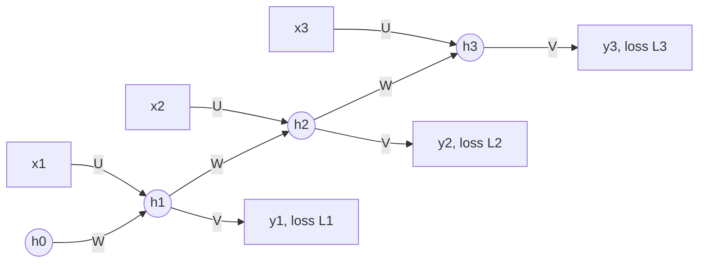

**In simple words:** a recurrent neural network (RNN) reads a sequence one item at a time and keeps a memory of what it has read so far. Its key components are the input, the hidden state (the memory), three weight sets shared across all time steps, the activations, the output and the loss.

**Why these components.** A sequence model must remember earlier items, accept inputs of any length and do the same job at every step. The hidden state gives the memory, and the shared weights let one network handle every step. <Cite id="gfdl-ch10" loc="§10.2" />

**The components**

1. **Input $x_t$:** one element of the sequence at time step $t$, for example a word turned into numbers.
2. **Hidden state $h_t$:** a vector that is the network's memory, a summary of everything seen up to step $t$. It starts as $h_0 = 0$.
3. **Input weights $U$:** decide how the new input changes the memory.
4. **Recurrent weights $W$:** connect the previous memory to the new one. This loop is what makes the network "recurrent".
5. **Output weights $V$:** turn the memory into an output.
6. **Biases $b$, $c$:** shift the sums, as in any neuron.
7. **Activations:** tanh in the hidden state (keeps values between $-1$ and $1$); softmax at the output for classes, or none for a number.
8. **Output $\hat{y}_t$:** produced at every step, or only at the last step (for example in sentiment analysis).
9. **Loss:** one loss per output step, added up over the sequence.

**How they work together.** The new memory is tanh of (W times the old memory, plus U times the input, plus b). The output is softmax of (V times the memory, plus c):

$$
h_t = \tanh\left(W h_{t-1} + U x_t + b\right), \qquad \hat{y}_t = \text{softmax}\left(V h_t + c\right)
$$

**Parameter sharing.** The same $U$, $W$, $V$, $b$, $c$ are used at every step, so the network handles any length and the number of weights does not grow with the length. <Cite id="keras-simplernn" />

**Training: BPTT.** The RNN is unfolded over time and trained by backpropagation through time. The gradients of the shared weights are added over all steps. <Cite id="d2l-rnn" />

**Advantages:** any sequence length, few parameters, memory of the past. **Limitations:** vanishing or exploding gradients over long sequences, and slow step-by-step processing. LSTM and GRU reduce the memory problem.

**Applications:** text generation, speech recognition, sentiment analysis, time-series forecasting. <Cite id="gfg-rnn" /> <Cite id="av-rnn" />

**Conclusion:** the hidden state with its recurrent weights, shared across time, is the component that lets an RNN model sequences.
