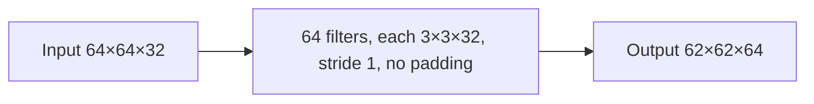

**In simple words:** har filter ko saare 32 input channels cover karne hain, isliye ek filter ke 3 × 3 × 32 weights hote hain. Total ke liye 64 filters se multiply karo. Ye Module 4 ka exercise hai (given information likho, formulas likho, phir calculate karo). <Cite id="class-dl-m4" loc="p. 30" />

**Definition:** convolution layer ke parameters uske saare filters ke weights ki sankhya hoti hai (aur har filter ka ek bias, agar bias count karein). Stride aur padding output size badalte hain, weights ki sankhya nahi. <Cite id="class-dl-chp4" loc="slide 27" /> <Cite id="class-dl-chp4" loc="slide 66" />

<Sum>

<Given>

input 64×64 aur 32 channels; 3×3 size ke 64 filters, har ek har channel par lagta hai; stride 1; padding nahi.

</Given>

<Find>

layer ke total parameters (weights).

</Find>

<Steps>

1. **Formula:** har filter ke weights $= F \times F \times D$ aur total weights $= F \times F \times D \times K$, jahan $D$ input depth aur $K$ filters ki sankhya.
2. **Ek filter ke weights:** $3 \times 3 \times 32 = 288$, kyunki filter saare 32 channels cover karta hai.
3. **Saare filters ke weights:** $288 \times 64 = 18{,}432$.
4. **Biases** (har filter ka ek, agar count karein): $64$, to total $18{,}432 + 64 = 18{,}496$.
5. **Output size** (diagram ke liye): $(64 - 3)/1 + 1 = 62$, to 62×62×64.

</Steps>

<Answer>

**18,432 weights** (64 biases ke saath 18,496 parameters); output 62×62×64.

</Answer>

<Box kind="verify">

Combined formula: $(3 \cdot 3 \cdot 32 + 1) \times 64 = 289 \times 64 = 18{,}496$, jo $18{,}432 + 64$ ke barabar hai. Image size 64×64 count mein kahin nahi aaya, jaise "weight sharing" rule kehta hai.

</Box>

</Sum>

**Conclusion:** layer ke 18,432 weights hain; ye sirf filter size, input depth aur filters ki sankhya par depend karte hain.
