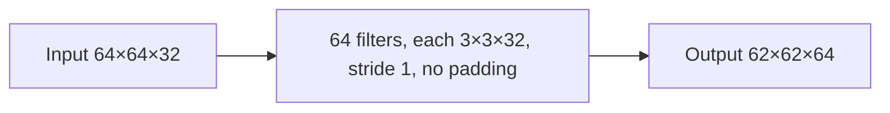

**In simple words:** each filter must cover all 32 input channels, so one filter has 3 × 3 × 32 weights. Multiply by the 64 filters for the total. This is the exercise of Module 4 (write the given information, the formulas, then calculate). <Cite id="class-dl-m4" loc="p. 30" />

**Definition:** the number of parameters of a convolution layer is the number of weights in all its filters (plus one bias per filter, if the bias is counted). Stride and padding change the output size, not the number of weights. <Cite id="class-dl-chp4" loc="slide 27" /> <Cite id="class-dl-chp4" loc="slide 66" />

<Sum>

<Given>

input 64×64 with 32 channels; 64 filters of size 3×3, each applied to every channel; stride 1; no padding.

</Given>

<Find>

the total number of parameters (weights) of the layer.

</Find>

<Steps>

1. **Formula:** weights per filter $= F \times F \times D$ and total weights $= F \times F \times D \times K$, where $D$ is the input depth and $K$ the number of filters.
2. **Weights per filter:** $3 \times 3 \times 32 = 288$, because the filter covers all 32 channels.
3. **Weights of all filters:** $288 \times 64 = 18{,}432$.
4. **Biases** (one per filter, if counted): $64$, so $18{,}432 + 64 = 18{,}496$ in all.
5. **Output size** (for the diagram): $(64 - 3)/1 + 1 = 62$, so 62×62×64.

</Steps>

<Answer>

**18,432 weights** (18,496 parameters with the 64 biases); output 62×62×64.

</Answer>

<Box kind="verify">

Use the combined formula: $(3 \cdot 3 \cdot 32 + 1) \times 64 = 289 \times 64 = 18{,}496$, which equals $18{,}432 + 64$. The image size 64×64 never appeared in the count, as the "weight sharing" rule says.

</Box>

</Sum>

**Conclusion:** the layer has 18,432 weights; they depend on the filter size, the input depth and the number of filters only.
