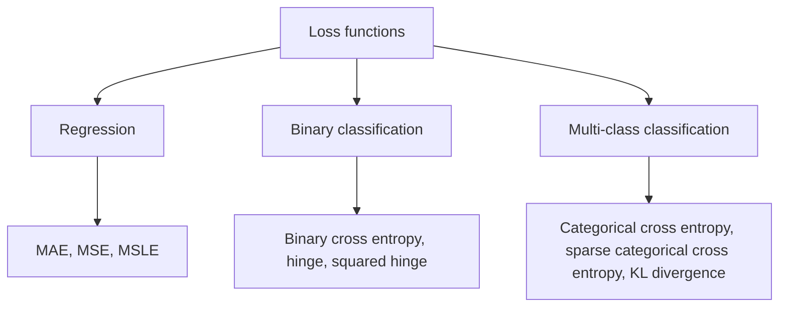

**In simple words:** loss function naapta hai ki network ki prediction kitni galat hai. Training is number ko chhota karne ki koshish karti hai. <Cite id="class-dl-chp2" loc="slide 26" />

**Definition aur significance:** loss function ek mathematical function hai jo predicted output aur actual output ka difference naapta hai. Small loss matlab prediction correct answer ke paas hai; large loss matlab door hai. Error naape bina network improve nahi kar sakta: loss backpropagation se peeche bheja jaata hai weights update karne ke liye, aur ye tab tak repeat hota hai jab tak loss chhota na ho jaaye. Kam loss matlab behtar model. <Cite id="class-dl-chp2" loc="slide 26" /> <Cite id="class-dl-chp2" loc="slide 27" />

**Loss functions ke types** <Cite id="class-dl-chp2" loc="slide 27" />

1. **Regression (number predict karna):**
   - **MAE** $= \frac{1}{n}\sum \lvert y_i - \hat y_i \rvert$: average absolute error; har error barabar maana jaata hai.
   - **MSE** $= \frac{1}{n}\sum (y_i - \hat y_i)^2$: error ko square karta hai, isliye bade errors ko zyada penalty; outliers ke prati sensitive.
   - **MSLE** $= \frac{1}{n}\sum (\log(1 + y_i) - \log(1 + \hat y_i))^2$: relative error, badi range wale positive values ke liye.
2. **Binary classification (do classes, sigmoid output):**
   - **Binary cross entropy** $= -[y\log\hat y + (1 - y)\log(1 - \hat y)]$: confident galat prediction par bada loss.
   - **Hinge loss** $= \max(0, 1 - y\hat y)$ (SVM, labels +1 aur −1) aur **squared hinge loss**, uska squared version.
3. **Multi-class classification (softmax output):**
   - **Categorical cross entropy** $= -\sum y_i\log\hat y_i$ one-hot labels ke saath; **sparse categorical cross entropy** integer labels ke saath; **KL divergence** do probability distributions compare karta hai.

**Chunna:** linear output ke saath MSE ya MAE; sigmoid ke saath binary cross entropy; softmax ke saath categorical cross entropy. <Cite id="class-dl-chp2" loc="slide 52" />

**Conclusion:** loss function training ka dil hai; sahi loss problem type se chuna jaata hai aur output function se match kiya jaata hai.
