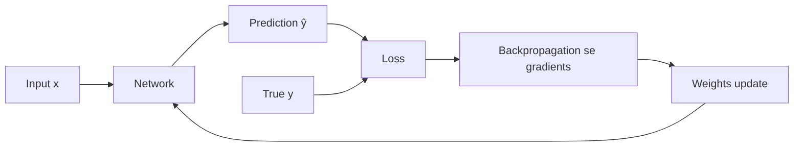

**In simple words:** loss function batata hai ki network ka prediction kitna galat hai, ek number mein. Training ka matlab hai weights badalna taaki ye number jitna chhota ho sake utna ho.

**Definition.** Loss function true answer $y$ ko prediction $\hat{y}$ se compare karta hai. Perfect answer ke liye ye 0 deta hai, aur galat answer ke liye bada number. **Cost** training set pe average loss hai. Dart socho: loss ye hai ki bull's-eye se kitni door giri.

**Significance**

1. **Performance measure karta hai**, ek number mein, jise training ke dauran track kar sakte hain.
2. **Learning chalata hai.** Iska gradient batata hai ki har weight kis taraf badle. Loss nahi to learning nahi.
3. **"Achha" ki definition deta hai.** Squared error network ko average answer predict karwata hai; absolute error median. <Cite id="gfdl-ch6" loc="§6.2.1.2" />
4. **Task aur output layer se match karna chahiye.** Galat loss se gradients bahut chhote ho sakte hain aur training ruk sakti hai.

**Training mein kaise kaam karta hai.** (1) Forward pass prediction deta hai. (2) Loss use score karta hai. (3) Backpropagation har weight ka gradient nikaalta hai. (4) Gradient descent weights ko downhill le jaata hai. (5) Repeat.

**Loss functions ke types**

*Regression (number predict karna), linear output ke saath:*

- **Mean squared error (MSE):** true aur predicted values ke difference ke squares ka average. Smooth hai, par bade errors hawi ho jaate hain. House prices, temperature ke liye.
- **Mean absolute error (MAE):** plain differences ka average. Outliers ke against robust, par zero ke paas kam smooth.
- **Huber loss:** chhote errors ke liye squared, bade ke liye absolute. MSE jaisa smooth, MAE jaisa robust. <Cite id="wiki-huber-loss" />

*Classification (class predict karna), sigmoid ya softmax output ke saath:*

- **Binary cross-entropy:** do classes ke liye (jaise spam ya nahi). Ye correct answer ko di gayi probability ka minus log hai, to confident galat answer pe bada loss aata hai.
- **Categorical cross-entropy:** many classes ke liye wahi idea, softmax output ke saath. Digit ya image classes ke liye.
- **Hinge loss:** zero tabhi jab correct class safe margin se jeete. SVM-style classifiers mein use hota hai; probabilities nahi deta.

**Loss chunna**

| Task | Output layer | Loss |
|---|---|---|
| Regression | Linear | MSE / MAE / Huber |
| Binary classification | Sigmoid | Binary cross-entropy |
| Multi-class | Softmax | Categorical cross-entropy |

Classification ke liye cross-entropy pasand kiya jaata hai. Sigmoid ya softmax output ke saath iska gradient tab bhi bada rehta hai jab network bahut galat ho, jabki MSE ka gradient flat sigmoid se chhota ho kar ruk jaata hai. <Cite id="gfdl-ch6" loc="§6.2.2.2" /> <Cite id="keras-losses" />

**Conclusion.** Loss function wo target hai jiske taraf poori training jaati hai. Numeric output ke liye MSE-type, class probabilities ke liye cross-entropy.

Exam mein English mein likho: "The loss function measures the error between the predicted and true output and guides training."
