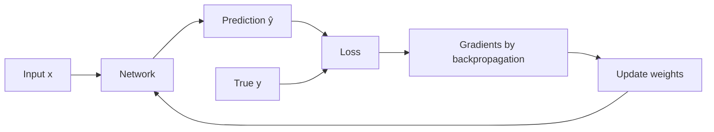

**In simple words:** a loss function measures how wrong the network's prediction is, as one number. Training means changing the weights to make that number as small as possible.

**Definition.** A loss function compares the true answer $y$ with the prediction $\hat{y}$. It returns 0 for a perfect answer and a bigger number for a worse one. The **cost** is the average loss over the training set. Think of a dart: the loss is how far it lands from the bull's-eye.

**Significance**

1. **Measures performance** as one number we can track during training.
2. **Drives learning.** Its gradient tells each weight which way to move. No loss, no learning.
3. **Defines "good".** Squared error makes the network predict the average answer; absolute error makes it predict the median. <Cite id="gfdl-ch6" loc="§6.2.1.2" />
4. **Must match the task and the output layer.** A mismatched loss can give tiny gradients and stall training.

**How it works in training.** (1) The forward pass gives a prediction. (2) The loss scores it. (3) Backpropagation finds each weight's gradient. (4) Gradient descent moves the weights downhill. (5) Repeat.

**Types of loss functions**

*For regression (predicting a number), with a linear output:*

- **Mean squared error (MSE):** the average of the squared differences between true and predicted values. Smooth, but big errors dominate. Used for house prices and temperature.
- **Mean absolute error (MAE):** the average of the plain differences. Robust to outliers, but less smooth near zero.
- **Huber loss:** squared for small errors, absolute for large ones. Smooth like MSE, robust like MAE. <Cite id="wiki-huber-loss" />

*For classification (predicting a class), with a sigmoid or softmax output:*

- **Binary cross-entropy:** for two classes, such as spam or not spam. It is minus the log of the probability the network gave to the correct answer, so a confident wrong answer gets a large loss.
- **Categorical cross-entropy:** the same idea for many classes with a softmax output. Used for digit or image classes.
- **Hinge loss:** zero only when the correct class wins by a safe margin. Used by SVM-style classifiers; it gives no probabilities.

**Choosing a loss**

| Task | Output layer | Loss |
|---|---|---|
| Regression | Linear | MSE / MAE / Huber |
| Binary classification | Sigmoid | Binary cross-entropy |
| Multi-class | Softmax | Categorical cross-entropy |

Cross-entropy is preferred for classification. With sigmoid or softmax outputs, its gradient stays large when the network is badly wrong, while the MSE gradient is shrunk by the flat sigmoid and stalls. <Cite id="gfdl-ch6" loc="§6.2.2.2" /> <Cite id="keras-losses" />

**Conclusion.** The loss function is the target the whole training aims at. MSE-type losses suit numeric outputs; cross-entropy suits probability outputs for classes.
