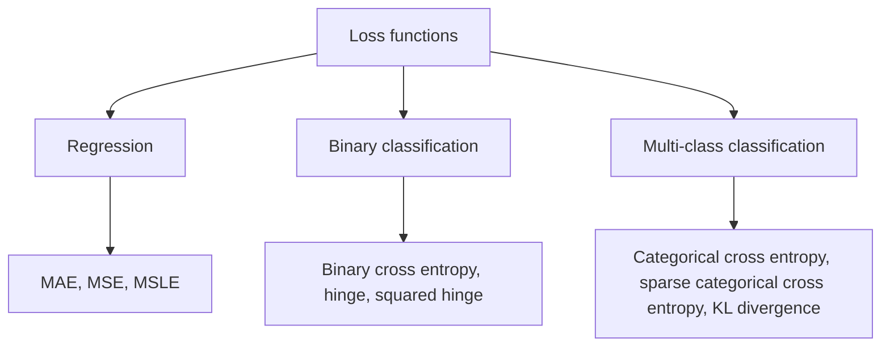

**In simple words:** a loss function measures how wrong the network's prediction is. Training tries to make this number small. <Cite id="class-dl-chp2" loc="slide 26" />

**Definition and significance:** a loss function is a mathematical function that measures the difference between the predicted output and the actual output. Small loss means the prediction is close to the correct answer; large loss means it is far. Without measuring the error the network cannot improve: the loss is sent back by backpropagation to update the weights, and this repeats until the loss is small. Lower loss means a better model. <Cite id="class-dl-chp2" loc="slide 26" /> <Cite id="class-dl-chp2" loc="slide 27" />

**Types of loss functions** <Cite id="class-dl-chp2" loc="slide 27" />

1. **Regression (predicting a number):**
   - **MAE** $= \frac{1}{n}\sum \lvert y_i - \hat y_i \rvert$: average absolute error; every error counts equally.
   - **MSE** $= \frac{1}{n}\sum (y_i - \hat y_i)^2$: squares the error, so large errors get a higher penalty; sensitive to outliers.
   - **MSLE** $= \frac{1}{n}\sum (\log(1 + y_i) - \log(1 + \hat y_i))^2$: relative error, for positive values with a large range.
2. **Binary classification (two classes, sigmoid output):**
   - **Binary cross entropy** $= -[y\log\hat y + (1 - y)\log(1 - \hat y)]$: large loss for a confident wrong prediction.
   - **Hinge loss** $= \max(0, 1 - y\hat y)$ (SVM, labels +1 and −1) and **squared hinge loss**, its squared version.
3. **Multi-class classification (softmax output):**
   - **Categorical cross entropy** $= -\sum y_i\log\hat y_i$ with one-hot labels; **sparse categorical cross entropy** with integer labels; **KL divergence** compares two probability distributions.

**Choosing:** linear output with MSE or MAE; sigmoid with binary cross entropy; softmax with categorical cross entropy. <Cite id="class-dl-chp2" loc="slide 52" />

**Conclusion:** the loss function is the heart of training; the right loss is chosen from the problem type and matched to the output function.
