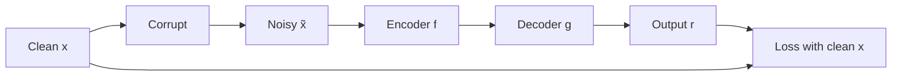

**In simple words:** autoencoder apne input ko ek chhote code mein dabaata hai aur us code se input wapas banata hai. Training aisi hoti hai ki output input jaisa ho. Agar kuch rokta nahi, to bada network bas input copy karta hai aur kuch useful nahi seekhta. Har type copy karne ke against ek alag rule jodta hai. Yahan teen regularized types hain (undercomplete autoencoder, jiska code input se chhota hota hai, ek aur valid choice hai).

**1. Denoising autoencoder (DAE)**

- **Kya hai:** ek autoencoder jisko corrupt input diya jaata hai, aur use saaf original output karna hota hai.
- **Kyun:** noise copy karne pe saza milti hai, to use data ka structure seekhna padta hai, jaise dhundhla page sahi tareeke se dobara likhna.
- **Kaise:** kuch input values ko 0 karo ya random noise jodo, encode karo, decode karo, aur output ko saaf input se compare karo.
- **Pros / cons:** robust features seekhta hai; mukhya roop se wahi noise hataata hai jispe train hua.
- **Use:** image aur audio denoising.

**2. Sparse autoencoder**

- **Kya hai:** code bada ho sakta hai, par kisi bhi input ke liye code ke sirf kuch neurons active ho sakte hain.
- **Kyun:** har neuron ek hi pattern mein specialise karta hai, to features rich hote hain aur network seedha copy nahi kar sakta.
- **Kaise:** code activations pe penalty jodte hain. Aam tareeka hai KL-divergence penalty, jo har neuron ki average activity ko ek chhote target, jaise 0.05, ke paas rakhta hai.
- **Pros / cons:** samajhne mein aasaan features; tune karne ke liye extra settings.
- **Use:** classification ke liye features.

**3. Contractive autoencoder (CAE)**

- **Kya hai:** input thoda badalne pe code bahut kam badalta hai, jaise car ka suspension chhote bumps sokh leta hai.
- **Kyun:** chhote, bematlab badlaav features ko nahi badalne chahiye, to features robust ban jaate hain.
- **Kaise:** ek penalty jodte hain jo har code value ki har input value ke respect mein squared slopes ka sum hai. Reconstruction loss code ko real badlaavon ke prati responsive rakhta hai.
- **Pros / cons:** robust features jo data ki real directions follow karte hain; bade layers ke liye penalty mehngi padti hai.
- **Use:** robust feature extraction.

**Comparison**

| Type | Rule against copying | Penalty on |
|---|---|---|
| Denoising | Noisy input se clean input rebuild karna | Kuch extra nahi; input corrupt hai |
| Sparse | Code ke kam neurons active | Code activations |
| Contractive | Chhote input badlaav pe code insensitive | Code ke slopes |

**Conclusion:** teeno regularized autoencoders hain. Bada code hone pe bhi ye bina labels ke useful features seekhte hain.

Exam mein English mein likho: "A denoising autoencoder is trained to rebuild a clean input from a corrupted one."
