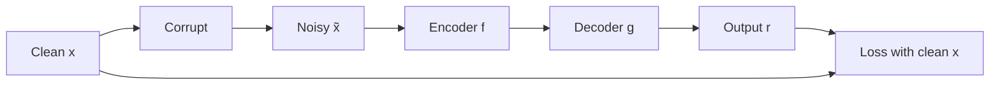

**In simple words:** an autoencoder squeezes its input into a short code and rebuilds the input from that code, trained so the output matches the input. If nothing stops it, a big network just copies the input and learns nothing useful. Each type adds a different rule against copying. Here are three regularized types (an undercomplete autoencoder, with a code smaller than the input, is another valid choice).

**1. Denoising autoencoder (DAE)**

- **What it is:** an autoencoder fed a corrupted input that must output the clean original.
- **Why:** copying the noise is punished, so it must learn the structure of the data, like rewriting a smudged page correctly.
- **How:** set some input values to 0 or add random noise, encode, decode, and compare the output with the clean input.
- **Pros / cons:** learns robust features; removes mainly the kind of noise it was trained on.
- **Use:** image and audio denoising.

**2. Sparse autoencoder**

- **What it is:** the code can be large, but only a few code neurons may be active for any one input.
- **Why:** each neuron specialises in one pattern, so the features are rich and the network cannot simply copy.
- **How:** add a penalty on the size of the code activations. A common choice is a KL-divergence penalty that keeps each neuron's average activity close to a small target, such as 0.05.
- **Pros / cons:** interpretable features; extra settings to tune.
- **Use:** features for classification.

**3. Contractive autoencoder (CAE)**

- **What it is:** the code hardly changes when the input changes a little, like a car suspension that absorbs small bumps.
- **Why:** tiny, meaningless changes should not change the features, so the features become robust.
- **How:** add a penalty equal to the sum of the squared slopes of every code value with respect to every input value. The reconstruction loss keeps the code responsive to real changes.
- **Pros / cons:** robust features that follow the real directions in the data; the penalty is costly for large layers.
- **Use:** robust feature extraction.

**Comparison**

| Type | Rule against copying | Penalty on |
|---|---|---|
| Denoising | Rebuild the clean input from a noisy one | Nothing extra; the input is corrupted |
| Sparse | Few active code neurons | Code activations |
| Contractive | Code insensitive to tiny input changes | Slopes of the code |

**Conclusion:** all three are regularized autoencoders. Even with a large code, they learn useful features without labels.
