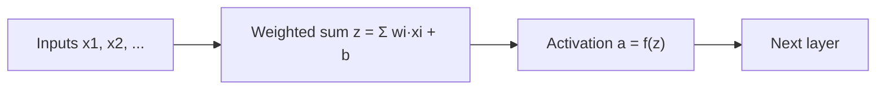

**In simple words:** neuron pehle apne weighted inputs ka sum karta hai, phir total ko ek activation function se guzaarta hai. Yahi function neural network ko straight-line model se zyada banata hai.

**Definition.** Activation function ek fixed rule $f$ hai jo neuron ke weighted sum $z$ ko output $a = f(z)$ mein badalta hai.

**Significance**

- **Non-linearity jodta hai.** Iske bina kitni bhi layers ek straight-line layer ban jaati hain. Images aur speech jaise real data ko curved boundaries chahiye, jo sirf non-linear function de sakta hai. <Cite id="gfdl-ch6" loc="§6.1" />
- **Output ka shape banata hai,** jaise score ko probability mein badalna.
- **Gradient flow control karta hai.** Training mein saari layers ki slopes multiply hoti hain. Jo function flat (saturate) ho jaata hai, wo early layers ko bahut slow seekhne deta hai. <Cite id="gfdl-ch6" loc="§6.3" />

**Types**

1. **Linear:** output input ke barabar hai, to koi bend nahi. Zyadatar regression output pe, jaise price.
2. **Sigmoid,** $\sigma(z) = \dfrac{1}{1+e^{-z}}$: 0 se 1 tak S-curve. *Pro:* output probability jaisa padha jaata hai. *Con:* saturate hota hai, to gradients vanish ho jaate hain. Binary output pe use hota hai.
3. **Tanh:** −1 se 1 tak S-curve, zero pe centred. *Pro:* zero-centred aur centre pe sigmoid se steep, to hidden layers mein behtar. *Con:* phir bhi saturate hota hai. RNNs mein common. <Cite id="gfdl-ch6" loc="§6.3.2" />
4. **ReLU,** $\max(0, z)$: positives rakhta hai, negatives ko zero karta hai. *Pros:* positive inputs ke liye gradient nahi sikudta; sasta; sparse. *Con:* dying ReLU, jahan hamesha negative rehne wala neuron kabhi update nahi hota. Hidden layers ka default. <Cite id="glorot2011" />
5. **Leaky ReLU / PReLU:** negative inputs ke liye chhota slope (lagbhag 0.01), to neurons bahut kam die hote hain. PReLU ye slope training ke dauran seekhta hai. <Cite id="he2015prelu" />
6. **Softmax:** poori output list pe kaam karta hai aur class scores ko probabilities mein badalta hai jo 1 tak jodte hain. Digit recognition jaise multi-class outputs ke liye.

<Figure caption="Left: sigmoid, tanh aur ReLU ki shapes. Right: sigmoid aur tanh ki slopes, jo centre se door lagbhag zero ho jaati hain; isliye gradients inke saath vanish hote hain.">
  <CurvePlot curves="sigmoid,tanh,relu" x="-4,4" y="-1.2,2" xLabel="z" yLabel="f(z)" />
  <CurvePlot curves="sigmoid-derivative,tanh-derivative" x="-5,5" y="0,1.1" xLabel="z" yLabel="slope f′(z)" />
</Figure>

| | Range | Zero-centred | Saturates | Typical place |
|---|---|---|---|---|
| Sigmoid | (0, 1) | no | yes | Binary output |
| Tanh | (−1, 1) | yes | yes | RNN hidden |
| ReLU | [0, ∞) | no | no | Hidden layers |
| Softmax | (0, 1), sum 1 | no | can | Multi-class output |

**Conclusion.** Activation functions networks ko power dete hain aur decide karte hain ki wo kitni achhi train hote hain. Hidden layers mein ReLU (ya leaky ReLU) use hota hai; output mein linear, sigmoid ya softmax, ye answer number, yes/no, ya kai classes mein se ek hai, us par depend karta hai.

Exam mein English mein likho: "Activation functions add non-linearity so the network can learn curved decision boundaries."
