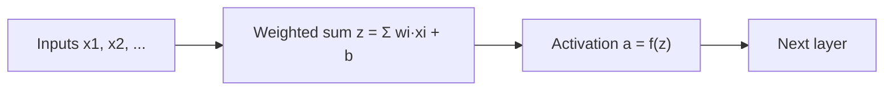

**In simple words:** a neuron first adds up its weighted inputs, then passes the total through an activation function. That function is what makes a neural network more than a straight-line model.

**Definition.** The activation function is a fixed rule $f$ that turns a neuron's weighted sum $z$ into its output $a = f(z)$.

**Significance**

- **Adds non-linearity.** Without it, any number of layers collapses into one straight-line layer. Real data such as images and speech need curved boundaries, which only a non-linear function allows. <Cite id="gfdl-ch6" loc="§6.1" />
- **Shapes the output,** for example turning a score into a probability.
- **Controls gradient flow.** Training multiplies the slopes of all the layers. A function that goes flat (saturates) makes early layers learn very slowly. <Cite id="gfdl-ch6" loc="§6.3" />

**Types**

1. **Linear:** output equals input, so there is no bend. Mainly used at a regression output, for example a price.
2. **Sigmoid,** $\sigma(z) = \dfrac{1}{1+e^{-z}}$: an S-curve from 0 to 1. *Pro:* the output reads as a probability. *Con:* it saturates, so gradients vanish. Used at a binary output.
3. **Tanh:** an S-curve from −1 to 1, centred on zero. *Pro:* zero-centred and steeper at the centre than sigmoid, so it works better in hidden layers. *Con:* still saturates. Common in RNNs. <Cite id="gfdl-ch6" loc="§6.3.2" />
4. **ReLU,** $\max(0, z)$: keeps positives and sets negatives to zero. *Pros:* no shrinking gradient for positive inputs; cheap; sparse. *Con:* dying ReLU, where a neuron that is always negative never updates. The default for hidden layers. <Cite id="glorot2011" />
5. **Leaky ReLU / PReLU:** a small slope (about 0.01) for negative inputs, so neurons are much less likely to die. PReLU learns that slope during training. <Cite id="he2015prelu" />
6. **Softmax:** works on the whole output list and turns class scores into probabilities that add up to 1. Used for multi-class outputs such as digit recognition.

<Figure caption="Left: the shapes of sigmoid, tanh and ReLU. Right: the slopes of sigmoid and tanh, which fall to almost zero away from the centre; that is why gradients vanish with them.">
  <CurvePlot curves="sigmoid,tanh,relu" x="-4,4" y="-1.2,2" xLabel="z" yLabel="f(z)" />
  <CurvePlot curves="sigmoid-derivative,tanh-derivative" x="-5,5" y="0,1.1" xLabel="z" yLabel="slope f′(z)" />
</Figure>

| | Range | Zero-centred | Saturates | Typical place |
|---|---|---|---|---|
| Sigmoid | (0, 1) | no | yes | Binary output |
| Tanh | (−1, 1) | yes | yes | RNN hidden |
| ReLU | [0, ∞) | no | no | Hidden layers |
| Softmax | (0, 1), sum 1 | no | can | Multi-class output |

**Conclusion.** Activation functions give networks their power and decide how well they train. ReLU (or leaky ReLU) is used in hidden layers; the output uses linear, sigmoid or softmax depending on whether the answer is a number, a yes/no, or one of many classes.
