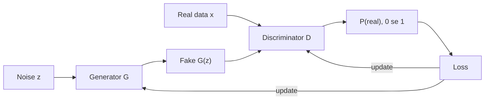

**In simple words:** Generative Adversarial Network (GAN) mein do networks ek doosre se compete karte hain. **Generator** random noise se fake data banata hai; **discriminator** decide karta hai ki data real hai ya fake. Compete karte karte generator realistic data banana seekh leta hai.

**Definition.** GAN ek generative model hai jisme generator aur discriminator ek doosre ke against train hote hain, jaise forger aur police officer. <Cite id="goodfellow2014" />

**Ye kyun zaroori hai.** Ye bina labels ke naya, realistic data bana sakta hai, aur har image ki exact probability compute karne ki zaroorat nahi padti.

**Architecture**

1. **Noise vector $z$:** random numbers (jaise bell curve se 100 values), ek sample ka seed.
2. **Generator $G$:** $z$ ko us shape ke sample mein badalta hai jaisa real data hota hai. Original GAN mein ye fully connected network hai; DCGAN mein transposed convolutions use hote hain jo image ko step by step bada karte hain, jaise $4 \times 4 \to 8 \times 8 \to \dots \to 64 \times 64$.
3. **Real data $x$:** training examples, labels ki zaroorat nahi.
4. **Discriminator $D$:** ek classifier (DCGAN mein CNN) jo 0 se 1 ke beech number deta hai, ki input real hone ki probability kya hai.
5. **Loss aur feedback:** D ki galtiyaan seedha D ko update karti hain, aur feedback D ke through wapas G ko update karta hai.

**Objective.** D chahta hai ki real data ko "real" aur fakes ko "fake" bole. G chahta hai ki D uske fakes ko "real" bole. Dono milkar ek minimax game banate hain:

$$
\min_G \max_D \; \mathbb{E}_{x \sim p_{\text{data}}}[\ln D(x)] + \mathbb{E}_{z \sim p_z}[\ln(1 - D(G(z)))]
$$

**Training.** Dono networks baari-baari se seekhte hain. G ko freeze karke D ko real (label 1) aur fake (label 0) data pe train karo; phir D ko freeze karke G ko train karo taaki D "real" bole. Ideal case mein fakes real data jaise ho jaate hain aur D har jagah $0.5$ deta hai.

**Fayde aur nuksaan.** Sharp, realistic output aur labels ki zaroorat nahi; lekin training unstable hoti hai, mode collapse hota hai (generator sirf kuch hi tarah ka output banata hai) aur evaluation mushkil hai.

**Applications**

- **Image generation:** realistic chehre, artwork, game characters.
- **Image-to-image translation:** sketch se photo, din se raat, horse se zebra.
- **Super-resolution:** low-resolution images ko sharp banana.
- **Inpainting aur editing:** missing hisse bharna, chehre ki umar badalna.
- **Data augmentation:** synthetic training data, jaise medical scans.
- **Deepfakes:** video mein chehre ya awaaz badalna. Film ke liye kaam ka hai, par fake news aur fraud ke liye misuse ho sakta hai.

**Conclusion:** GAN ek generator aur discriminator hai jo ek doosre ke against train hote hain; realistic images aur data banane mein ye bahut use hota hai.

Exam mein English mein likho: "A GAN has a generator that creates fake data and a discriminator that learns to tell real from fake."
