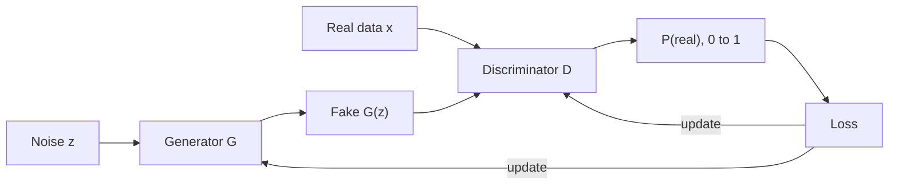

**In simple words:** a Generative Adversarial Network (GAN) has two networks that compete. The **generator** makes fake data from random noise; the **discriminator** decides whether data is real or fake. By competing, the generator learns to make realistic data.

**Definition.** A GAN is a generative model in which a generator and a discriminator are trained against each other, like a forger and a police officer. <Cite id="goodfellow2014" />

**Why it is needed.** It can create new, realistic data without labels, and it does not need to compute the exact probability of each image.

**Architecture**

1. **Noise vector $z$:** random numbers (for example 100 values from a bell curve), the seed of one sample.
2. **Generator $G$:** maps $z$ to a sample shaped like the real data. In the original GAN it is a fully connected network; in DCGAN it uses transposed convolutions that grow the image step by step, for example $4 \times 4 \to 8 \times 8 \to \dots \to 64 \times 64$.
3. **Real data $x$:** training examples, with no labels needed.
4. **Discriminator $D$:** a classifier (a CNN in DCGAN) that outputs a number from 0 to 1, the probability that its input is real.
5. **Loss and feedback:** D's mistakes update D directly, and the feedback flows back through D to update G.

**Objective.** D wants to say "real" to real data and "fake" to fakes. G wants D to say "real" to its fakes. Together this is a minimax game:

$$
\min_G \max_D \; \mathbb{E}_{x \sim p_{\text{data}}}[\ln D(x)] + \mathbb{E}_{z \sim p_z}[\ln(1 - D(G(z)))]
$$

**Training.** The networks take turns. Train D on real (label 1) and fake (label 0) data with G frozen; then train G so that D says "real", with D frozen. Ideally the fakes match the real data and D outputs $0.5$ everywhere.

**Advantages and disadvantages.** Sharp, realistic outputs with no labels needed; but unstable training, mode collapse (the generator makes only a few kinds of output) and hard evaluation.

**Applications**

- **Image generation:** realistic faces, artwork, game characters.
- **Image-to-image translation:** sketch to photo, day to night, horse to zebra.
- **Super-resolution:** turning low-resolution images into sharp ones.
- **Inpainting and editing:** filling missing regions, face aging.
- **Data augmentation:** synthetic training data, for example medical scans.
- **Deepfakes:** swapping faces or voices in video. Useful for film, but can be misused for fake news and fraud.

**Conclusion:** a GAN is a generator and a discriminator trained against each other; it is widely used to create realistic images and data.
