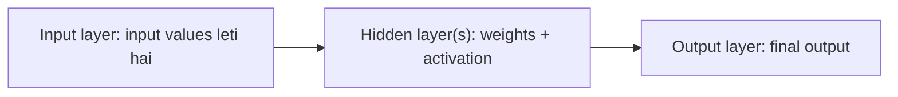

**In simple words:** feedforward neural network mein ek input layer, ek ya zyada hidden layers aur ek output layer hoti hai, aur data inmein sirf aage jaata hai. <Cite id="class-dl-chp1" loc="slide 28" />

**Layers:** **input layer** input values leti hai (har feature ke liye ek neuron); **hidden layers** weights aur activation function lagati hain; **output layer** final output deti hai. <Cite id="class-dl-chp1" loc="slide 28" />

**Har neuron ka working:** $z = \sum_i w_ix_i + b$ aur output $a = f(z)$. Steps: input diya jaata hai, inputs weights se multiply hote hain, bias add hota hai, activation function lagta hai, output agli layer ko jaata hai, aur final output milta hai. <Cite id="class-dl-chp1" loc="slide 28" />

**Architecture choices:** main choices depth (layers ki sankhya) aur width (har layer ki units) hain. Layers chain ki tarah jude hote hain; har unit agli layer ki har unit se connected hoti hai. <Cite id="class-dl-m1" loc="p. 23" />

**Conclusion:** feedforward network mein feedback ya loops nahi hote, aur output sirf current input par depend karta hai.
