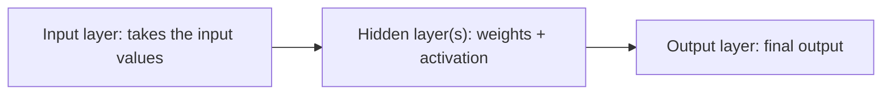

**In simple words:** a feedforward neural network has an input layer, one or more hidden layers and an output layer, and data moves only forward through them. <Cite id="class-dl-chp1" loc="slide 28" />

**Layers:** the **input layer** takes the input values (one neuron per feature); the **hidden layers** apply weights and an activation function; the **output layer** gives the final output. <Cite id="class-dl-chp1" loc="slide 28" />

**Working of each neuron:** $z = \sum_i w_ix_i + b$ and the output is $a = f(z)$. The steps are: input is given, inputs are multiplied with weights, bias is added, the activation function is applied, the output is passed to the next layer, and the final output is produced. <Cite id="class-dl-chp1" loc="slide 28" />

**Architecture choices:** the main choices are the depth (number of layers) and the width (units per layer). Layers are connected as a chain; every unit connects to every unit of the next layer. <Cite id="class-dl-m1" loc="p. 23" />

**Conclusion:** a feedforward network has no feedback or loops, and its output depends only on the current input.
