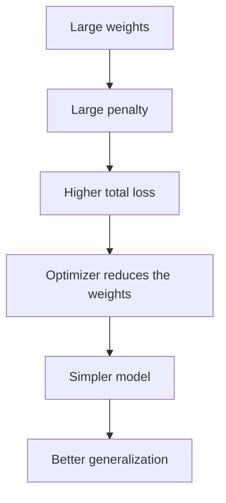

**In simple words:** regularization network ko training data ratta maarne se rokti hai, jab uske weights bade ho jaate hain to use saza dekar, taaki wo asli pattern seekhe. <Cite id="class-dl-chp2" loc="slide 97" />

**Definition:** regularization is a technique used to reduce overfitting by controlling the complexity of the model. Instead of allowing the model to memorize the training data, it encourages the model to learn only the important patterns. Its main goal is to improve generalization. <Cite id="class-dl-chp2" loc="slide 97" />

**Ye kyun zaroori hai:** network ki training accuracy bahut high ho sakti hai par testing accuracy poor (overfitting). Zyada epochs se train karna ise theek nahi karta, kyunki model data ratta maarne lagta hai. <Cite id="class-dl-chp2" loc="slide 97" />

**Kaise kaam karti hai:** regularization loss function mein penalty add karti hai. **Total Loss = Prediction Error + Regularization Penalty.** Bahut bade weights discourage hote hain, to model simple hota hai aur noise ke bajaye important features seekhta hai. Penalty ki strength λ set karta hai (chhota λ best, λ = 0 overfit, bada λ underfit). <Cite id="class-dl-chp2" loc="slides 97 and 99" />

**Types:** L1 (Lasso), L2 (Ridge), Elastic Net, weight decay, dropout, early stopping, data augmentation, noise injection, parameter sharing. <Cite id="class-dl-chp2" loc="slide 100" />

**Conclusion:** regularization thodi training accuracy dekar unseen data par kaafi better accuracy deti hai.

Exam mein English mein likho: "Regularization adds a penalty to the loss function to reduce overfitting and improve generalization."
