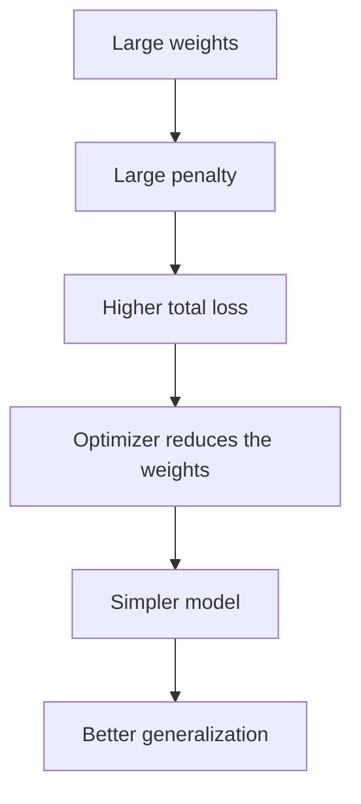

**In simple words:** regularization stops a network from memorizing its training data by punishing it when its weights become large, so it learns the real pattern. <Cite id="class-dl-chp2" loc="slide 97" />

**Definition:** regularization is a technique used to reduce overfitting by controlling the complexity of the model. Instead of allowing the model to memorize the training data, it encourages the model to learn only the important patterns. Its main goal is to improve generalization. <Cite id="class-dl-chp2" loc="slide 97" />

**Why it is needed:** a network can give very high training accuracy but poor testing accuracy (overfitting). Training for more epochs does not fix it, because the model starts to memorize the data. <Cite id="class-dl-chp2" loc="slide 97" />

**How it works:** regularization adds a penalty to the loss function. **Total Loss = Prediction Error + Regularization Penalty.** Very large weights are discouraged, so the model becomes simpler and learns important features instead of noise. The strength of the penalty is set by λ (small λ is best, λ = 0 overfits, large λ underfits). <Cite id="class-dl-chp2" loc="slides 97 and 99" />

**Types:** L1 (Lasso), L2 (Ridge), Elastic Net, weight decay, dropout, early stopping, data augmentation, noise injection, parameter sharing. <Cite id="class-dl-chp2" loc="slide 100" />

**Conclusion:** regularization trades a little training accuracy for much better accuracy on unseen data.
