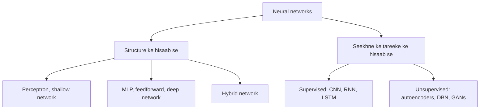

**In simple words:** neural networks ke alag types hote hain, is hisaab se ki unmein kitni layers hain aur wo kaise seekhte hain. Simplest perceptron hai; deeper aur special wale MLP, deep networks, hybrid networks, CNN, RNN, LSTM, autoencoders aur GANs hain. <Cite id="class-dl-chp1" loc="slide 25" />

1. **Perceptron:** simplest neural network, binary classification ke liye. Shallow network mein sirf input aur output layer hoti hai, isliye ye sirf linear problems solve karta hai aur XOR nahi. <Cite id="class-dl-chp1" loc="slide 13" /> <Cite id="class-dl-chp1" loc="slide 16" />
2. **Multi-Layer Perceptron (MLP) / feedforward network:** input layer, ek ya zyada hidden layers aur output layer, fully connected, information sirf aage jaati hai. Ye non-linear problems solve karta hai. <Cite id="class-dl-m1" loc="p. 17" />
3. **Deep neural network (DNN):** ek input layer, do ya zyada hidden layers aur ek output layer; ye pehle simple features aur gehri layers mein complex patterns seekhta hai. <Cite id="class-dl-chp2" loc="slide 2" />
4. **Hybrid network:** single network ki limits door karne ke liye alag types ke neural networks ko combine karta hai. <Cite id="class-dl-chp1" loc="slide 16" />
5. **CNN, RNN aur LSTM (supervised):** CNN images ke saath kaam karta hai; RNN hidden states se sequence data model karta hai; LSTM long-term dependencies ke liye special RNN hai.
6. **Autoencoder, DBN aur GAN (unsupervised):** autoencoders data compress karke rebuild karte hain; GAN generator aur discriminator se naya data generate karta hai.

**Conclusion:** network ka type zaroorat ke structure aur seekhne ke tareeke (supervised, unsupervised ya hybrid) se chuna jaata hai.
