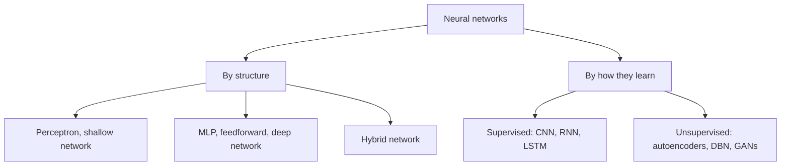

**In simple words:** neural networks are of different types depending on how many layers they have and how they learn. The simplest is the perceptron; deeper and special ones are MLP, deep networks, hybrid networks, CNN, RNN, LSTM, autoencoders and GANs. <Cite id="class-dl-chp1" loc="slide 25" />

1. **Perceptron:** the simplest neural network, for binary classification. A shallow network has only an input and an output layer, so it solves only linear problems and cannot solve XOR. <Cite id="class-dl-chp1" loc="slide 13" /> <Cite id="class-dl-chp1" loc="slide 16" />
2. **Multi-Layer Perceptron (MLP) / feedforward network:** input layer, one or more hidden layers and output layer, fully connected, information flows only forward. It solves non-linear problems. <Cite id="class-dl-m1" loc="p. 17" />
3. **Deep neural network (DNN):** one input layer, two or more hidden layers and one output layer; it learns simple features first and complex patterns in deeper layers. <Cite id="class-dl-chp2" loc="slide 2" />
4. **Hybrid network:** combines different types of neural networks to overcome the limits of a single network. <Cite id="class-dl-chp1" loc="slide 16" />
5. **CNN, RNN and LSTM (supervised):** CNN works with images; RNN models sequence data using hidden states; LSTM is a special RNN for long-term dependencies.
6. **Autoencoder, DBN and GAN (unsupervised):** autoencoders compress and rebuild data; a GAN generates new data using a generator and a discriminator.

**Conclusion:** the type of network is chosen from the structure needed and from how it learns (supervised, unsupervised or hybrid).
