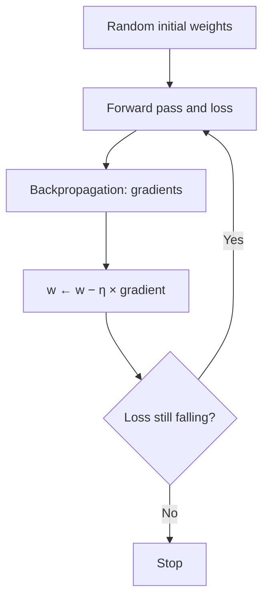

**In simple words:** gradient descent wo tareeka hai jisse neural network apne weights seekhta hai. Loss ko hilly zameen ki height samjho; hum slope (gradient) mehsoos karte hain aur neeche ki taraf kadam lete rehte hain jab tak ek low point na mil jaye.

**Basics.** *Weight* network ke andar ek number hai jo wo seekhta hai. *Loss* ek number hai jo batata hai ki predictions kitne galat hain. Kisi weight ka *gradient* uska loss ke hisaab se slope hai: ye batata hai ki weight badalne par loss kis taraf aur kitni tezi se badlega.

**Definition:** gradient descent ek iterative optimization algorithm hai jo har weight ko uske gradient ki ulti disha mein ek chhota step move karke loss ko minimise karta hai.

**Why needed:** network mein lakhon weights hote hain aur unki best values ke liye koi seedha formula nahi hai, lekin backpropagation har weight ki slope bata sakta hai.

**The algorithm**

1. Weights ko chhoti random values se initialise karo; learning rate $\eta$ choose karo.
2. Forward pass: predictions aur loss calculate karo.
3. Backward pass: har weight ke liye loss ka gradient calculate karo.
4. Har weight update karo: new weight = old weight − learning rate × gradient, $w \leftarrow w - \eta\,\dfrac{\partial L}{\partial w}$.
5. Loss girna band ho jaye ya epochs khatam ho jayein tak repeat karo.

Minus sign har weight ko neeche ki taraf bhejta hai. **Learning rate** ko dhyan se choose karna chahiye: bahut chhota ho to training slow hoti hai, bahut bada ho to overshoot karke diverge kar sakta hai.

**Types of gradient descent (ek step mein kitna data)**

*1. Batch gradient descent:* **saare** training examples ka average gradient leta hai, phir har epoch mein ek hi update karta hai. *Pros:* exact aur smooth path. *Cons:* bade data par slow aur memory-heavy.

*2. Stochastic gradient descent (SGD):* har **ek** random example ke baad update karta hai. *Pros:* sasta, fast, online kaam karta hai, noise shallow minima se bahar nikalne mein madad karta hai. *Cons:* noisy, zig-zag path; minimum ke paas hilta rehta hai.

*3. Mini-batch gradient descent:* chhote batch (32 se 256 examples) ke baad update karta hai. *Pros:* accuracy aur speed ka balance, GPU par achha chalta hai. *Cons:* batch size tune karna padta hai. Ye standard choice hai.

| | Batch | SGD | Mini-batch |
|---|---|---|---|
| Data per update | Saara | 1 | Chhota batch |
| Gradient | Exact | Bahut noisy | Thoda noisy |
| Speed | Slow | Fast | Fast |

**Improved variants (har step kaise liya jaata hai, ye badalte hain)**

- *Momentum:* velocity jodta hai jo pichle steps yaad rakhti hai; sidhi disha mein tez chalta hai aur zig-zag ko kam karta hai.
- *Nesterov:* momentum jaisa hi, lekin gradient ek aage ke point par measure karta hai, isliye kam overshoot karta hai.
- *AdaGrad:* har weight ko apni alag rate deta hai; jin weights ke past gradients bade the unki rate kam hoti hai; rate bahut zyada gir bhi sakti hai.
- *RMSProp:* squared gradients ka moving average leta hai, isliye rate khatam nahi hoti.
- *Adam:* momentum aur RMSProp, bias correction ke saath; sabse zyada use hone wale mein se ek.

**Advantages:** simple hai, kisi bhi size ke network par chalta hai. **Limitations:** learning rate ke prati sensitive; saddle points ya local minima par ruk sakta hai. **Applications:** CNN, RNN, transformers aur regression models ko train karna.

**Conclusion:** gradient descent training ka engine hai. Momentum ya Adam ke saath mini-batch gradient descent aaj ke zyadatar deep networks use karte hain.

Exam mein English mein likho: "Gradient descent is an iterative optimization algorithm that minimises the loss by updating each weight opposite to its gradient."
