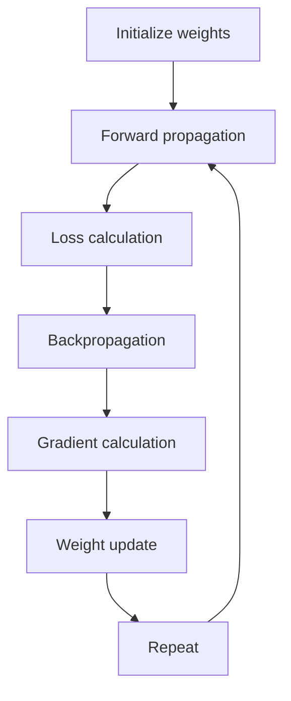

**In simple words:** gradient descent loss ka slope mehsoos karke neeche ki taraf steps leta hai aur sabse kam loss wale weights dhundta hai; uske types is mein alag hain ki har step ke liye kitna data use hota hai. <Cite id="class-dl-chp2" loc="slide 60" />

**Algorithm.** Gradient Descent (GD) is an optimization algorithm that updates the weights and biases to reduce the loss. Its goal is to find the minimum loss by moving the weights in the correct direction. <Cite id="class-dl-chp2" loc="slide 60" /> Chhe steps: weights randomly initialize karo, forward propagation, loss calculate karo, backpropagation se gradients calculate karo, weights update karo, loss minimum hone tak repeat karo. <Cite id="class-dl-chp2" loc="slide 63" />

**Update rule:** $W_{new} = W_{old} - \eta \dfrac{\partial L}{\partial W}$, jahan $\eta$ learning rate hai (chhota: slow, bada: minimum skip, proper: fast aur stable) aur $\dfrac{\partial L}{\partial W}$ gradient (slope). <Cite id="class-dl-chp2" loc="slide 63" />

**Types detail mein.**

- **Batch GD:** ek update ke liye poora dataset use karta hai (ek epoch mein ek update). Stable aur smooth, par bade datasets ke liye slow aur memory-heavy. <Cite id="class-dl-chp2" loc="slide 68" />
- **Stochastic GD (SGD):** har ek sample ke baad weights update karta hai: $W_{new} = W_{old} - \eta\, \partial L_i / \partial W$. Fast, kam memory, kuch local minima se nikal sakta hai, par noisy (zig-zag) aur learning rate ke prati sensitive. <Cite id="class-dl-chp2" loc="slides 68 to 70" />
- **Mini-batch GD:** har chhote batch (16, 32, 64, 128) ke baad update: batch GD se faster, SGD se zyada stable, GPU friendly, sabse commonly used version. <Cite id="class-dl-chp2" loc="slides 71 to 73" />
- **Improved variants:** momentum (pichla update yaad rakhta hai), Nesterov (aage dekhta hai), AdaGrad, RMSProp aur Adam (har weight ka apna learning rate). <Cite id="class-dl-chp2" loc="slide 59" />

| | Batch GD | SGD | Mini-batch GD |
|---|---|---|---|
| Uses | Entire dataset | One sample | Small batch |
| Updates per epoch | One | One per sample | One per batch |
| Path | Smooth | Zig-zag | Slight zig-zag |

**Limitation:** GD global minimum ki jagah local minimum ya saddle point par ruk sakta hai. <Cite id="class-dl-chp2" loc="slide 61" />

**Conclusion:** gradient descent saari training ka base hai; practice mein Adam ke saath mini-batch GD usual choice hai.

Exam mein English mein likho: "Gradient descent updates the weights in the direction opposite to the gradient: W new = W old - eta dL/dW."
