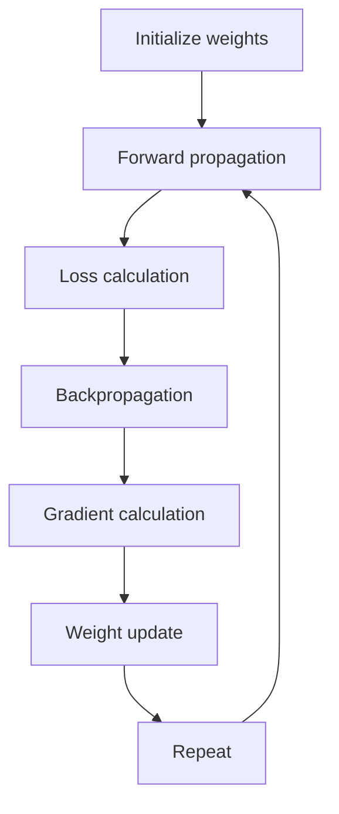

**In simple words:** gradient descent finds the weights with the least loss by feeling the slope of the loss and stepping downhill; its types differ in how much data is used for each step. <Cite id="class-dl-chp2" loc="slide 60" />

**The algorithm.** Gradient Descent (GD) is an optimization algorithm that updates the weights and biases to reduce the loss. Its goal is to find the minimum loss by moving the weights in the correct direction. <Cite id="class-dl-chp2" loc="slide 60" /> The six steps: initialize weights randomly, forward propagation, calculate the loss, backpropagation to calculate the gradients, update the weights, repeat until the loss is minimum. <Cite id="class-dl-chp2" loc="slide 63" />

**Update rule:** $W_{new} = W_{old} - \eta \dfrac{\partial L}{\partial W}$, where $\eta$ is the learning rate (small: slow, large: may skip the minimum, proper: fast and stable) and $\dfrac{\partial L}{\partial W}$ is the gradient (slope). <Cite id="class-dl-chp2" loc="slide 63" />

**Types in detail.**

- **Batch GD:** uses the entire dataset for one update (one update per epoch). Stable and smooth, but slow and memory-heavy for large datasets. <Cite id="class-dl-chp2" loc="slide 68" />
- **Stochastic GD (SGD):** updates the weights after each single sample: $W_{new} = W_{old} - \eta\, \partial L_i / \partial W$. Fast, low memory, can escape some local minima, but noisy (zig-zag) and sensitive to the learning rate. <Cite id="class-dl-chp2" loc="slides 68 to 70" />
- **Mini-batch GD:** updates after each small batch (16, 32, 64, 128): faster than batch GD, more stable than SGD, GPU friendly, the most commonly used version. <Cite id="class-dl-chp2" loc="slides 71 to 73" />
- **Improved variants:** momentum (remembers the previous update), Nesterov (looks ahead), AdaGrad, RMSProp and Adam (own learning rate per weight). <Cite id="class-dl-chp2" loc="slide 59" />

| | Batch GD | SGD | Mini-batch GD |
|---|---|---|---|
| Uses | Entire dataset | One sample | Small batch |
| Updates per epoch | One | One per sample | One per batch |
| Path | Smooth | Zig-zag | Slight zig-zag |

**Limitation:** GD may stop at a local minimum or a saddle point instead of the global minimum. <Cite id="class-dl-chp2" loc="slide 61" />

**Conclusion:** gradient descent is the base of all training; mini-batch GD with Adam is the usual choice in practice.
