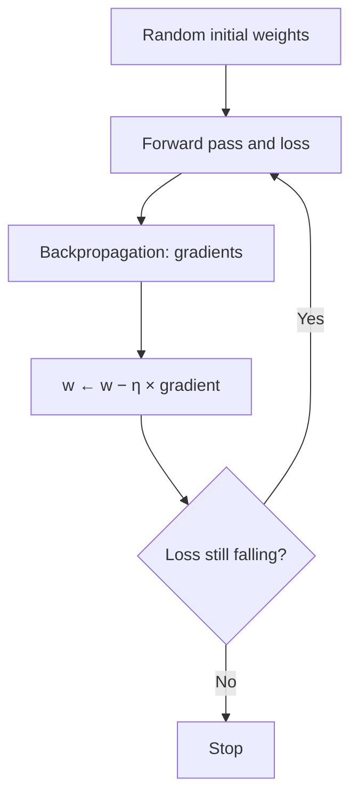

**In simple words:** gradient descent is how a neural network learns its weights. The loss is like the height of hilly ground; we feel the slope (the gradient) and keep stepping downhill until we reach a low point.

**Basics.** A *weight* is a number inside the network that it learns. The *loss* is one number that says how wrong the predictions are. The *gradient* of the loss for a weight is its slope: it tells us which way, and how steeply, the loss changes when that weight changes.

**Definition:** gradient descent is an iterative optimization algorithm that minimises the loss by moving every weight a small step opposite to its gradient.

**Why needed:** a network has millions of weights and no direct formula for their best values, but backpropagation can tell us the slope for each one.

**The algorithm**

1. Initialise the weights with small random values; choose the learning rate $\eta$.
2. Forward pass: compute the predictions and the loss.
3. Backward pass: compute the gradient of the loss for every weight.
4. Update every weight: new weight = old weight − learning rate × gradient, $w \leftarrow w - \eta\,\dfrac{\partial L}{\partial w}$.
5. Repeat until the loss stops decreasing or the epochs run out.

The minus sign sends each weight downhill. The **learning rate** must be chosen carefully: too small is slow, too large overshoots and can diverge.

**Types of gradient descent (by data per step)**

*1. Batch gradient descent:* averages the gradient over **all** training examples, then makes one update per epoch. *Pros:* exact, smooth path. *Cons:* slow and memory-heavy on big data.

*2. Stochastic gradient descent (SGD):* updates after **each single** random example. *Pros:* cheap, fast, works online, noise can escape shallow minima. *Cons:* noisy, zig-zag path; wobbles near the minimum.

*3. Mini-batch gradient descent:* updates after each small batch (32 to 256 examples). *Pros:* balances accuracy and speed, runs well on GPUs. *Cons:* batch size must be tuned. The standard choice.

| | Batch | SGD | Mini-batch |
|---|---|---|---|
| Data per update | All | 1 | Small batch |
| Gradient | Exact | Very noisy | Slightly noisy |
| Speed | Slow | Fast | Fast |

**Improved variants (change how each step is taken)**

- *Momentum:* adds a velocity that remembers past steps, speeding up steady directions and damping zig-zags.
- *Nesterov:* like momentum but measures the gradient at the look-ahead point, so it overshoots less.
- *AdaGrad:* gives each weight its own rate, shrinking it for weights with large past gradients; the rate can shrink too much.
- *RMSProp:* uses a moving average of squared gradients, so the rate does not die out.
- *Adam:* momentum plus RMSProp with bias correction; one of the most widely used.

**Advantages:** simple, works for any network size. **Limitations:** sensitive to the learning rate; can stall at saddle points or local minima. **Applications:** training CNNs, RNNs, transformers and regression models.

**Conclusion:** gradient descent is the engine of training. Mini-batch gradient descent with momentum or Adam is what most deep networks use today.
