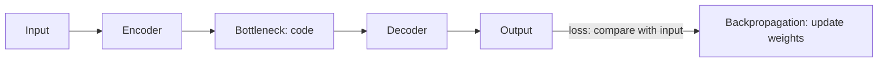

**In simple words:** autoencoder apne input ko chhote code mein squeeze karta hai aur phir us code se input wapas banata hai. Kyunki use chhote code se input rebuild karna hai, wo bina labels ke important features seekhta hai. <Cite id="class-dl-chp3" loc="slide 2" />

**Working.** (1) Input (image/data) diya jaata hai. (2) Encoder ise compress karta hai. (3) Bottleneck important information store karta hai. (4) Decoder original data reconstruct karta hai. (5) Output ko input se compare kiya jaata hai. (6) Loss (MSE $= \dfrac{1}{n}\sum (x_i - \hat x_i)^2$ ya L1) calculate hota hai. (7) Backpropagation weights update karta hai. (8) Output input jaisa hone tak repeat. <Cite id="class-dl-chp3" loc="slides 2 and 3" />

**Types detail mein.** <Cite id="class-dl-chp3" loc="slide 8" />

| Type | Idea | Purpose |
|---|---|---|
| Vanilla | Basic encoder + decoder | Compress aur reconstruct |
| Linear | Sirf linear activations (PCA jaisa) | Simple linear relationships |
| Undercomplete | Code input se chhota | Compression force karta hai, important features seekhta hai |
| Overcomplete | Code input se bada | Detailed features; regularization chahiye warna input copy karta hai |
| Sparse | Sirf kuch neurons active (sparsity penalty) | Memorization se bachata hai |
| Contractive | Input mein chhota change to code mein chhota change (contractive penalty) | Robust, stable features |
| Denoising | Noisy input, clean target | Noise hataata hai |
| Convolutional | Dense layers ke bajaye conv layers | Image compression, denoising |
| Variational (VAE) | Distribution (μ, σ²) seekhta hai, z sample karta hai | Naya data generate karta hai; loss = reconstruction + KL divergence |

**Advantages:** labels nahi chahiye, data compress karta hai, useful features seekhta hai, redundancy hataata hai. **Disadvantages:** output hamesha identical nahi, kuch information kho sakti hai, bottleneck size achhe se chunna padta hai. **Applications:** compression, denoising, dimensionality reduction, feature extraction, anomaly detection, generation (VAE). <Cite id="class-dl-chp3" loc="slides 3 and 34" />

**Conclusion:** nau types sirf us extra rule mein alag hain jo network ko copy nahi, seekhne par majboor karta hai.

Exam mein English mein likho: "The types of autoencoders differ in the extra constraint that forces the network to learn instead of copy."
