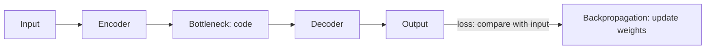

**In simple words:** an autoencoder squeezes its input into a short code and then rebuilds the input from that code. Because it must rebuild the input from a short code, it learns the important features without any labels. <Cite id="class-dl-chp3" loc="slide 2" />

**Working.** (1) The input (image/data) is given. (2) The encoder compresses it. (3) The bottleneck stores the important information. (4) The decoder reconstructs the original data. (5) The output is compared with the input. (6) The loss (MSE $= \dfrac{1}{n}\sum (x_i - \hat x_i)^2$ or L1) is calculated. (7) Backpropagation updates the weights. (8) Repeat until the output is similar to the input. <Cite id="class-dl-chp3" loc="slides 2 and 3" />

**Types in detail.** <Cite id="class-dl-chp3" loc="slide 8" />

| Type | Idea | Purpose |
|---|---|---|
| Vanilla | Basic encoder + decoder | Compress and reconstruct |
| Linear | Only linear activations (like PCA) | Simple linear relationships |
| Undercomplete | Code smaller than input | Forces compression, learns important features |
| Overcomplete | Code larger than input | Detailed features; needs regularization or it copies the input |
| Sparse | Only a few neurons active (sparsity penalty) | Avoids memorization |
| Contractive | Small input change gives small code change (contractive penalty) | Robust, stable features |
| Denoising | Noisy input, clean target | Removes noise |
| Convolutional | Conv layers instead of dense layers | Image compression, denoising |
| Variational (VAE) | Learns a distribution (μ, σ²), samples z | Generates new data; loss = reconstruction + KL divergence |

**Advantages:** no labels, compresses data, learns useful features, removes redundancy. **Disadvantages:** output is not always identical, some information may be lost, bottleneck size must be chosen well. **Applications:** compression, denoising, dimensionality reduction, feature extraction, anomaly detection, generation (VAE). <Cite id="class-dl-chp3" loc="slides 3 and 34" />

**Conclusion:** the nine types differ only in the extra rule that forces the network to learn rather than copy.
