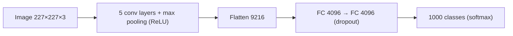
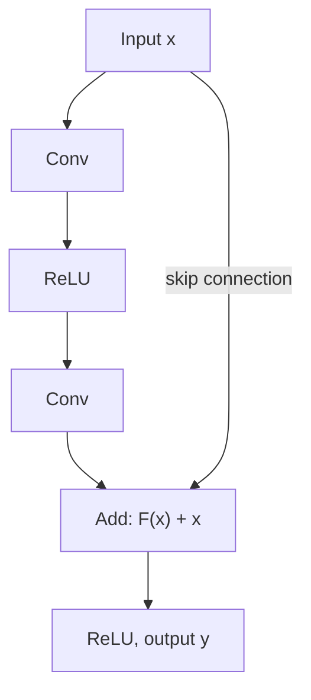

**In simple words:** main class ke do modern CNNs draw karta hoon, AlexNet (wo deep CNN jisne ImageNet 2012 jeeta) aur ResNet (bahut deep models ke liye skip connections wala network). <Cite id="class-dl-chp4" loc="slide 40" />

**1. AlexNet (2012).** 5 convolution aur 3 fully connected layers wala deep CNN: input 227×227×3, Conv1 (96 filters 11×11, stride 4) se 55×55×96, phir max pooling, Conv2, Conv3 se Conv5, max pooling, FC 4096, FC 4096 aur softmax ke saath 1000 classes. Features: ReLU (tanh se lagbhag 6 guna tez), GPU training, max pooling, overfitting ke khilaf dropout 0.5 aur data augmentation. Lagbhag 62 million parameters. <Cite id="class-dl-chp4" loc="slide 48" /> <Cite id="class-dl-m4" loc="p. 55" />

**2. ResNet (2015).** Bahut deep networks degradation problem se jujhte hain: zyada layers training mushkil bana deti hain aur accuracy badhna ruk jaati hai. ResNet **skip (shortcut) connections** jodta hai taaki information aur gradients aasani se flow karein. Block residual $F(x) = H(x) - x$ seekhta hai, isliye output $y = F(x) + x$. Jab sizes alag hon to shortcut par 1×1 convolution use hota hai. Versions: ResNet-18, 34, 50, 101, 152; ResNet-152 ne ILSVRC 2015 jeeta (top-5 error 3.57%). <Cite id="class-dl-chp4" loc="slide 49" /> <Cite id="class-dl-m4" loc="p. 77" />

**Conclusion:** AlexNet ne dikhaya ki ReLU, dropout aur GPUs ke saath deep CNNs kaam karte hain; ResNet ne dikhaya ki skip connections se hum bahut deeper ja sakte hain. <Cite id="class-dl-m4" loc="p. 86" />
