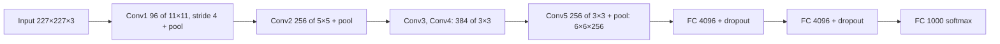
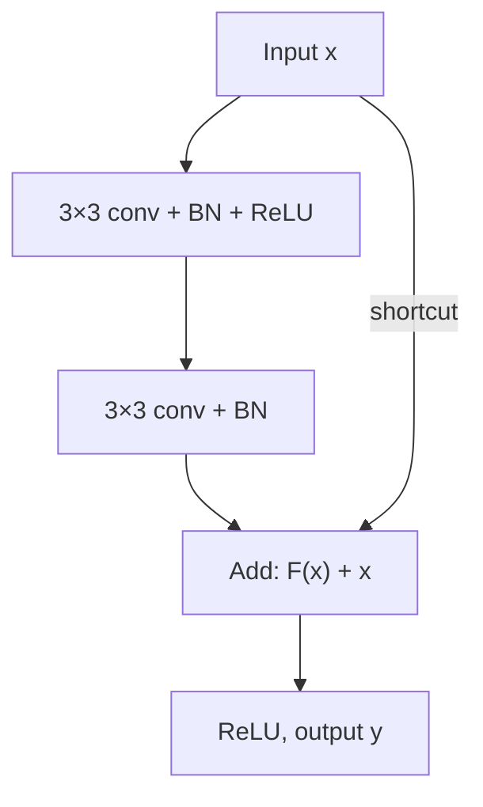

**In simple words:** do milestone deep CNNs hain: **AlexNet** (2012), jisne ReLU, dropout aur GPUs se CNNs ko bada aur fast banaya, aur **ResNet** (2015), jisne skip connections jode taaki 100 se zyada layers ke networks train ho sakein.

**1. AlexNet (Krizhevsky, Sutskever, Hinton, 2012)**

*Why:* ImageNet ke liye bana ek 8-layer CNN (1.2 million colour photos, 1000 classes), chhote networks jaise LeNet ke liye ye kaam bahut mushkil tha.

- *Size:* 5 convolutional + 3 fully connected layers, lagbhag 60 million parameters, zyadatar FC layers mein.
- *New ideas:* **ReLU** (tanh se tez training), overlapping max pooling, pehli do FC layers mein **dropout** 0.5, **data augmentation**, **do GPUs** par training.
- *Result:* ILSVRC-2012 jeeta, 15.3% top-5 error ke saath, runner-up ke 26.2% ke muqable.

**2. ResNet (He et al., 2015)**

*Why:* ek plain network ko aur deep karne (jaise 18 se 34 layers) se uska **training** error bhi badh gaya. Ise degradation problem kehte hain, aur ye overfitting nahi hai.

*How:* har block sirf change (residual) seekhta hai aur apna input shortcut ke through wapas jod deta hai:

$$
y = F(x) + x
$$

$x$ block ka input hai, $F(x)$ uske do 3×3 conv layers ka output, $y$ block ka output. Agar "kuch na karna" best ho, to layers bas $F(x)$ ko 0 ke paas le jaati hain. Gradient ka ek seedha raasta bhi shortcut ke through peeche jaata hai, isliye ye gayab hone ki sambhavna kaafi kam hoti hai.

- *Layers (ResNet-34):* 7×7 conv, max pool, phir 3, 4, 6, 3 residual blocks jinmein 64, 128, 256, 512 filters hain, global average pooling, ek FC layer. ResNet-50/101/152 1×1 → 3×3 → 1×1 bottleneck blocks use karte hain.
- *Result:* 152 layers tak; ek ensemble ne ILSVRC 2015 jeeta, 3.57% top-5 error ke saath. Identity shortcuts koi extra parameters nahi jodte.

**Applications:** image classification, aur detection tatha medical imaging ke liye pretrained backbones.

**Conclusion:** AlexNet ne saabit kiya ki deep CNNs bade paimane par kaam karte hain; ResNet ke skip connections ne bahut deep networks ko trainable banaya.

Exam mein English mein likho: "ResNet uses skip connections, which add the block input to the output of its layers so very deep networks can be trained."
