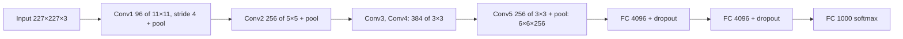
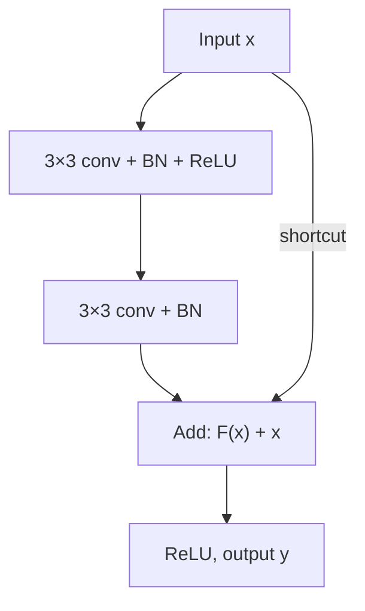

**In simple words:** two milestone deep CNNs are **AlexNet** (2012), which made CNNs big and fast with ReLU, dropout and GPUs, and **ResNet** (2015), which added skip connections so that networks over 100 layers deep could be trained.

**1. AlexNet (Krizhevsky, Sutskever, Hinton, 2012)**

*Why:* an 8-layer CNN built for ImageNet (1.2 million colour photos, 1000 classes), far too hard for small networks like LeNet.

- *Size:* 5 convolutional + 3 fully connected layers, about 60 million parameters, mostly in the FC layers.
- *New ideas:* **ReLU** (faster training than tanh), overlapping max pooling, **dropout** 0.5 in the first two FC layers, **data augmentation**, training on **two GPUs**.
- *Result:* won ILSVRC-2012 with 15.3% top-5 error, against 26.2% for the runner-up.

**2. ResNet (He et al., 2015)**

*Why:* making a plain network deeper (for example 18 to 34 layers) made even its **training** error worse. This is the degradation problem, and it is not overfitting.

*How:* each block learns only the change (the residual) and adds its input back through a shortcut:

$$
y = F(x) + x
$$

$x$ is the block input, $F(x)$ the output of its two 3×3 conv layers, $y$ the block output. If "do nothing" is best, the layers just make $F(x)$ close to 0. The gradient also has a direct path back through the shortcut, so it is much less likely to vanish.

- *Layers (ResNet-34):* 7×7 conv, max pool, then 3, 4, 6, 3 residual blocks with 64, 128, 256, 512 filters, global average pooling, one FC layer. ResNet-50/101/152 use 1×1 → 3×3 → 1×1 bottleneck blocks.
- *Result:* up to 152 layers; an ensemble won ILSVRC 2015 with 3.57% top-5 error. Identity shortcuts add no parameters.

**Applications:** image classification, and pretrained backbones for detection and medical imaging.

**Conclusion:** AlexNet proved deep CNNs work at scale; ResNet's skip connections made very deep networks trainable.
