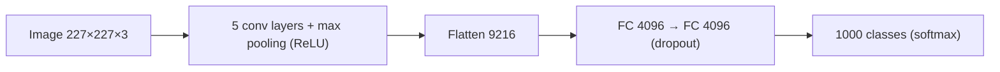
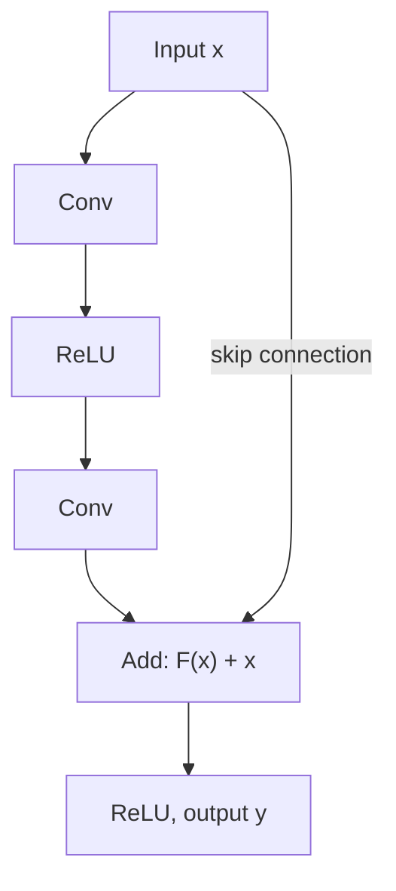

**In simple words:** I draw two modern CNNs of the class, AlexNet (the deep CNN that won ImageNet 2012) and ResNet (the network with skip connections for very deep models). <Cite id="class-dl-chp4" loc="slide 40" />

**1. AlexNet (2012).** A deep CNN with 5 convolution and 3 fully connected layers: input 227×227×3, Conv1 (96 filters 11×11, stride 4) gives 55×55×96, then max pooling, Conv2, Conv3 to Conv5, max pooling, FC 4096, FC 4096 and 1000 classes with softmax. Features: ReLU (about 6 times faster than tanh), GPU training, max pooling, dropout 0.5 and data augmentation against overfitting. About 62 million parameters. <Cite id="class-dl-chp4" loc="slide 48" /> <Cite id="class-dl-m4" loc="p. 55" />

**2. ResNet (2015).** Very deep networks suffer from the degradation problem: more layers make training difficult and accuracy stops improving. ResNet adds **skip (shortcut) connections** so information and gradients flow more easily. The block learns the residual $F(x) = H(x) - x$, so the output is $y = F(x) + x$. A 1×1 convolution on the shortcut is used when the sizes differ. Versions: ResNet-18, 34, 50, 101, 152; ResNet-152 won ILSVRC 2015 (top-5 error 3.57%). <Cite id="class-dl-chp4" loc="slide 49" /> <Cite id="class-dl-m4" loc="p. 77" />

**Conclusion:** AlexNet showed that deep CNNs with ReLU, dropout and GPUs work; ResNet showed that skip connections let us go much deeper. <Cite id="class-dl-m4" loc="p. 86" />
