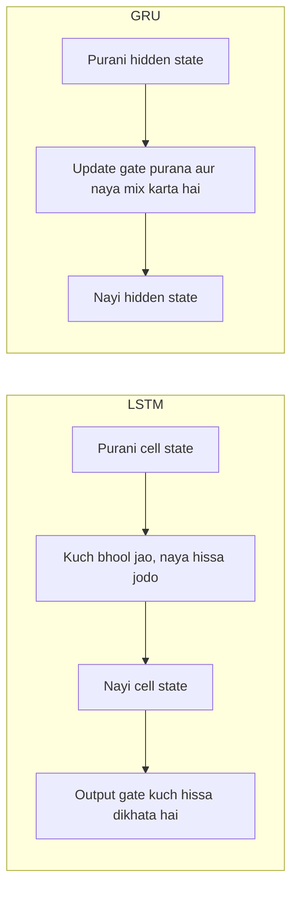

**In simple words:** LSTM aur GRU improved RNN cells hain. Dono gates use karte hain, yaani 0 aur 1 ke beech ke numbers jo nal (tap) ki tarah kaam karte hain, aur decide karte hain kya yaad rakhna hai. Isse ye wo long-range patterns seekh sakte hain jo plain RNN bhool jaata hai. GRU dono mein simple aur tez hai.

**Why they are needed.** Plain RNN har step par apni memory dobara likh deta hai, isliye training mein gradients vanish ho jaate hain aur wo purane inputs bhool jaata hai. Gated cells purani memory ko aage blend karke rakhte hain. <Cite id="gfdl-ch10" loc="§10.10" />

**LSTM in brief** (Hochreiter aur Schmidhuber, 1997) <Cite id="hochreiter1997" />

- Do states: **cell state** (long-term memory) aur **hidden state** (output).
- **Forget gate:** purani memory kitni rakhni hai. **Input gate:** naya candidate kitna jodna hai. **Output gate:** memory mein se kitna output mein dikhana hai.
- Nayi memory = purani memory forget gate se scale hoti hai, plus naya candidate input gate se scale hota hai. Output wo memory hai, jo chhoti range mein squash hoti hai aur output gate se scale hoti hai.

**GRU in brief** (Cho et al., 2014) <Cite id="cho2014" />

- Ek hi state: sirf **hidden state**.
- **Update gate:** purani memory kitni rakhni hai; baaki hissa naye information ke liye hota hai. **Reset gate:** naya candidate banate waqt purani memory kitni use karni hai.
- Nayi state purani state aur naye candidate ka blend hai, aur update gate mix decide karta hai.

**Differences**

| Point | LSTM | GRU |
|---|---|---|
| Number of gates | 3 (forget, input, output) | 2 (update, reset) |
| States | Cell state and hidden state | Hidden state only |
| Forgetting and adding | Separate gates, independent | Coupled: ek gate dono decide karta hai, keep aur add |
| Output gate | Present | Absent |
| Parameters | 4 weight sets | 3 weight sets, lagbhag 25% kam |
| Training speed | Slower | Faster, kam memory |
| Long dependencies | Bahut lambe sequences par aksar better | Chhote aur medium sequences par aksar barabar |
| Data needed | Bade dataset se faida | Chhote dataset mein aksar theek |
| Typical use | Translation, speech, lambe documents | Mobile ya real-time models, chhote dataset |

**What is common.** Dono purani state ko nayi state mein blend karke memory rakhte hain, use poora dobara nahi likhte, isliye gradients kai steps tak peeche jaate hain. Comparisons mein dono accuracy mein lagbhag ek jaise paaye gaye, aur koi bhi lagataar better nahi tha. <Cite id="chung2014" /> <Cite id="av-lstm-gru" /> <Cite id="gfg-rnn-lstm-gru" />

**Conclusion:** speed aur chhote data ke liye GRU chuno, aur bahut lambi-avadhi memory par sabse zyada control ke liye LSTM.

Exam mein English mein likho: "Both LSTM and GRU use gates to control memory; LSTM has three gates and a separate cell state, while GRU has two gates and only a hidden state."
