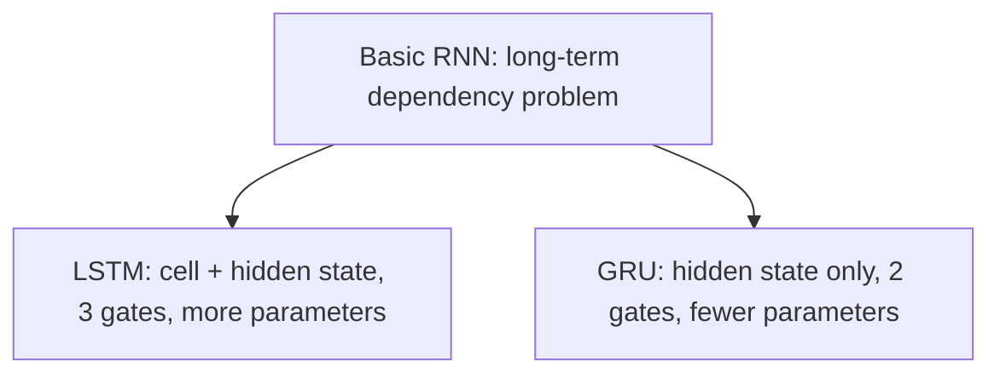

**In simple words:** LSTM aur GRU dono gates se plain RNN ki memory problem fix karte hain. LSTM bada, zyada powerful cell hai; GRU halka cell hai.

**Dono kyun hain:** basic RNN mein long-term dependency problem hai, isliye LSTM ek solution hai aur GRU doosra. <Cite id="class-dl-chp5" loc="slide 20" />

**LSTM:** do memories (cell state = long-term, hidden state = short-term) aur teen gates: forget (purani information hatao), input (nayi information jodo) aur output (kya dikhana hai chuno). **GRU:** ek memory (hidden state) aur do gates: reset (past ka kitna use karna) aur update (kitni purani aur nayi information rakhni). <Cite id="class-dl-m5" loc="p. 21" /> <Cite id="class-dl-m5" loc="p. 28" />

| Feature | LSTM | GRU |
|---|---|---|
| Main memory | Cell state + hidden state | Hidden state |
| Gates | Forget, input, output (3) | Reset, update (2) |
| Structure | Zyada complex | Simpler |
| Parameters | Zyada | Kam |

**Example:** LSTM: $0.2 \times 10 + 0.8 \times 5 = 6$ (forget gate aur input gate). GRU: $0.7 \times 10 + 0.3 \times 4 = 8.2$ (update gate). <Cite id="class-dl-chp5" loc="slide 17" /> <Cite id="class-dl-chp5" loc="slide 21" />

**Kab kaunsa:** LSTM zyada powerful aur effective hai kyunki usme 2 ki jagah 3 gates hain; GRU ka architecture simpler hai, isliye hum bade models bana sakte hain. <Cite id="class-dl-m5" loc="p. 31" />

**Conclusion:** dono basic RNN se behtar long-term dependencies handle karte hain, lekin information alag tareeke se control karte hain.
