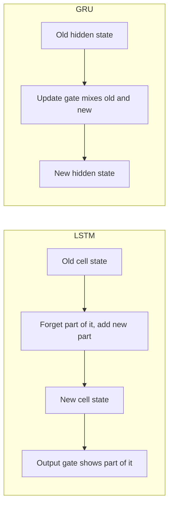

**In simple words:** LSTM and GRU are improved RNN cells. Both use gates, numbers between 0 and 1 that act like taps, to decide what to remember, so they can learn long-range patterns that a plain RNN forgets. The GRU is the simpler and faster of the two.

**Why they are needed.** A plain RNN rewrites its memory at every step, so during training its gradients vanish and it forgets long-ago inputs. Gated cells keep old memory by blending it forward. <Cite id="gfdl-ch10" loc="§10.10" />

**LSTM in brief** (Hochreiter and Schmidhuber, 1997) <Cite id="hochreiter1997" />

- Two states: a **cell state** (long-term memory) and a **hidden state** (the output).
- **Forget gate:** how much old memory to keep. **Input gate:** how much of the new candidate to add. **Output gate:** how much of the memory to show as output.
- The new memory is the old memory scaled by the forget gate, plus the new candidate scaled by the input gate. The output is that memory, squashed into a small range, scaled by the output gate.

**GRU in brief** (Cho et al., 2014) <Cite id="cho2014" />

- One state: the **hidden state** only.
- **Update gate:** how much old memory to keep; the rest of the choice goes to new information. **Reset gate:** how much old memory to use when making the new candidate.
- The new state is a blend of the old state and the new candidate, and the update gate decides the mix.

**Differences**

| Point | LSTM | GRU |
|---|---|---|
| Number of gates | 3 (forget, input, output) | 2 (update, reset) |
| States | Cell state and hidden state | Hidden state only |
| Forgetting and adding | Separate gates, independent | Coupled: one gate decides both keep and add |
| Output gate | Present | Absent |
| Parameters | 4 weight sets | 3 weight sets, about 25% fewer |
| Training speed | Slower | Faster, less memory |
| Long dependencies | Often better on very long sequences | Often equal on short and medium ones |
| Data needed | Benefits from large datasets | Often fine with smaller datasets |
| Typical use | Translation, speech, long documents | Mobile or real-time models, smaller datasets |

**What is common.** Both keep memory by blending the old state into the new one instead of rewriting it, so gradients flow back many steps. Comparisons found them similar in accuracy, with neither consistently better. <Cite id="chung2014" /> <Cite id="av-lstm-gru" /> <Cite id="gfg-rnn-lstm-gru" />

**Conclusion:** choose GRU for speed and smaller data, LSTM for the most control over very long-term memory.
