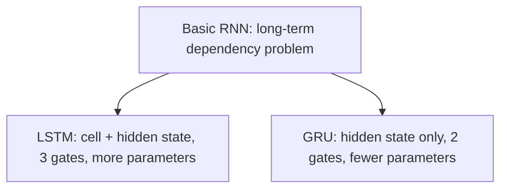

**In simple words:** LSTM and GRU both fix the memory problem of the plain RNN by using gates. LSTM is the bigger, more powerful cell; GRU is the lighter one.

**Why both exist:** a basic RNN has the long-term dependency problem, so LSTM is one solution and GRU is another. <Cite id="class-dl-chp5" loc="slide 20" />

**LSTM:** two memories (cell state = long-term, hidden state = short-term) and three gates, forget (remove old information), input (add new information) and output (select what to show). **GRU:** one memory (the hidden state) and two gates, reset (how much past to use) and update (how much old and new information to keep). <Cite id="class-dl-m5" loc="p. 21" /> <Cite id="class-dl-m5" loc="p. 28" />

| Feature | LSTM | GRU |
|---|---|---|
| Main memory | Cell state + hidden state | Hidden state |
| Gates | Forget, input, output (3) | Reset, update (2) |
| Structure | More complex | Simpler |
| Parameters | More | Fewer |

**Example:** LSTM: $0.2 \times 10 + 0.8 \times 5 = 6$ (forget gate and input gate). GRU: $0.7 \times 10 + 0.3 \times 4 = 8.2$ (update gate). <Cite id="class-dl-chp5" loc="slide 17" /> <Cite id="class-dl-chp5" loc="slide 21" />

**Which to use:** LSTM is more powerful and effective because it has 3 gates instead of 2; GRU has a simpler architecture, so we can build bigger models. <Cite id="class-dl-m5" loc="p. 31" />

**Conclusion:** both handle long-term dependencies better than a basic RNN, but they control information in different ways.
