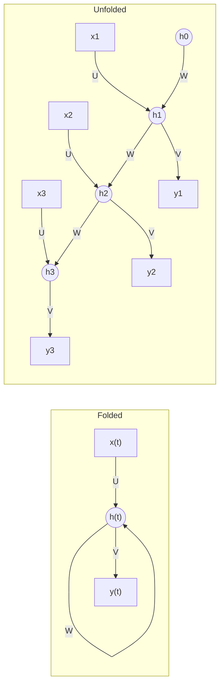

**In simple words:** RNN (recurrent neural network) kaam karta hai waise hi jaise koi insaan kahani ek-ek word karke padhta hai aur apne dimaag mein ek running summary rakhta hai. Ye summary, jise hidden state kehte hain, har step par naye input aur purane summary se update hoti hai, aur us step ka output isi se banta hai.

**Why it is needed.** Ek feedforward network har input ko alag se dekhta hai aur fixed input size chahiye, isliye woh pehle ke words use nahi kar sakta. RNN mein ek loop hota hai jo memory ko ek step se agle step tak le jaata hai.

**Kaam kaise hota hai, step by step**

1. Empty memory se shuru karo: $h_0 = 0$.
2. Step $t$ par input $x_t$ aur pichli memory $h_{t-1}$ lo.
3. Dono ko weights se combine karo, bias add karo aur tanh lagao: yeh nayi memory hai.
4. Is step ka output nayi memory se banao.
5. Agle step par jao aur **same** weights se repeat karo jab tak sequence khatam na ho.

Formulas mein <Cite id="gfdl-ch10" loc="§10.2" />:

$$
h_t = \tanh(W h_{t-1} + U x_t + b), \qquad \hat{y}_t = \text{softmax}(V h_t + c)
$$

Yahan $U$ input-to-hidden weight matrix hai, $W$ hidden-to-hidden (recurrent) matrix hai jo memory aage le jaata hai, $V$ hidden-to-output matrix hai, aur $b$, $c$ biases hain.

**Diagram**

**Diagram ko kaise padhein.** Folded roop mein W loop hidden state ko khud par wapas bhejta hai. Unfolding mein har time step ki ek copy banti hai: $h_1$ $x_1$ par depend karta hai, $h_2$ $x_2$ aur $h_1$ par, aur aise hi. Isliye aakhri state pehle ke har input ki information leti hai.

**Types.** Ek-se-bahut (image captioning), bahut-se-ek (sentiment), bahut-se-bahut (translation, tagging). <Cite id="karpathy-rnn" />

**Training.** Backpropagation through time: network ko unfold karo, sab steps ke losses jodo, chain ke through backpropagate karo, aur shared weights ke gradients ko add karo. <Cite id="d2l-rnn" />

**Advantages:** koi bhi sequence length chalti hai, kam parameters kyunki weights shared hain, past ki memory rakhta hai. **Disadvantages:** lambe sequence par gradients vanish ya explode ho jaate hain, isliye door ke inputs bhool jaata hai; steps ek ke baad ek chalte hain, isliye slow hai. Lambi-range memory ke liye LSTM aur GRU use hote hain.

**Applications:** text generation, speech recognition, machine translation, time-series forecasting. <Cite id="gfg-rnn" /> <Cite id="ibm-rnn" />

Exam mein English mein likho: "At each time step, the RNN combines the current input with the previous hidden state."

**Conclusion:** RNN ek sequence ko step by step, shared weights aur hidden state ke saath process karta hai, jo memory ko ek step se agle step tak le jaata hai.
