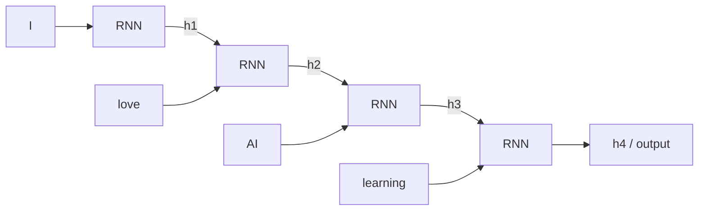

**In simple words:** RNN wo data padhta hai jo order mein aata hai, ek-ek step mein. Har step par wo naye input ko past ki memory (hidden state) ke saath mix karta hai aur updated memory aage pass karta hai.

**Definition:** RNN ek type ka neural network hai jisme hidden states hote hain aur jo pichhle outputs ko inputs ki tarah use karne deta hai. Ye sequential data ke liye bana hai: "I will process the current input, but I will also carry some information from previous steps." <Cite id="class-dl-m5" loc="p. 9" /> <Cite id="class-dl-chp5" loc="slide 3" />

**Working, step by step** <Cite id="class-dl-chp5" loc="slide 7" />

1. Pehle word aur khali memory se shuru karo.
2. Har time step par cell **current input** aur **previous hidden state** leta hai aur **new hidden state** aur ek **output** banata hai.
3. New hidden state agle step ko pass hoti hai. "Recurrent" matlab repeated: har element ke liye same cell aur same weights.
4. Equations mein: $h_t = \tanh(U x_t + W h_{t-1} + b)$, $\hat{y}_t = \text{softmax}(V h_t + c)$.

**Learning:** forward pass ke baad prediction ko target se compare karke loss nikalte hain; **BPTT** error ko time steps mein peeche bhejta hai, aur weights update hote hain. <Cite id="class-dl-chp5" loc="slide 10" />

**Use:** sentiment analysis (many to one), image captioning (one to many), translation (many to many), speech recognition, next-word prediction. <Cite id="class-dl-chp5" loc="slide 8" /> <Cite id="class-dl-chp5" loc="slide 13" />

**Conclusion:** RNN = sequential data + previous information + hidden state.
