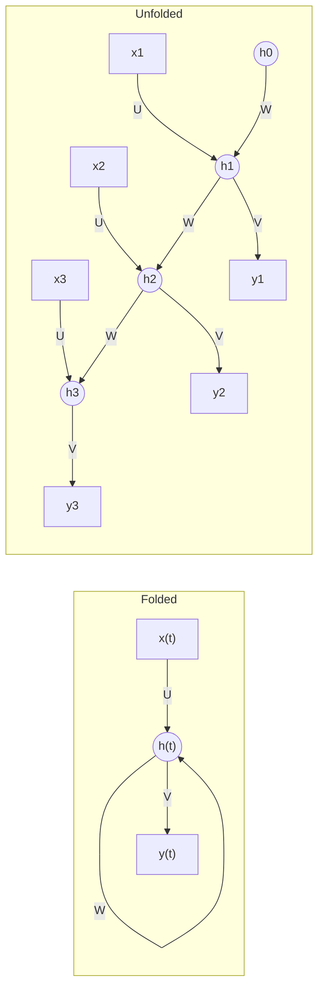

**In simple words:** an RNN (recurrent neural network) works like a person reading a story: it reads one word at a time and keeps a running summary in its head. The summary, called the hidden state, is updated at each step using the new input and the old summary, and the output at each step is made from it.

**Why it is needed.** A feedforward network sees each input on its own and needs a fixed input size, so it cannot use earlier words. An RNN adds a loop that carries memory from one step to the next.

**Working, step by step**

1. Start with an empty memory $h_0 = 0$.
2. At step $t$, take the input $x_t$ and the previous memory $h_{t-1}$.
3. Combine them through weights, add a bias and apply tanh: this is the new memory.
4. Make the output for this step from the new memory.
5. Move to the next step and repeat with the **same** weights until the sequence ends.

In symbols <Cite id="gfdl-ch10" loc="§10.2" />:

$$
h_t = \tanh(W h_{t-1} + U x_t + b), \qquad \hat{y}_t = \text{softmax}(V h_t + c)
$$

Here $U$ is the input-to-hidden weight matrix, $W$ the hidden-to-hidden (recurrent) matrix that carries memory, $V$ the hidden-to-output matrix, and $b$, $c$ biases.

**Diagram**

**Reading the diagram.** The folded form shows the loop $W$ feeding the hidden state back to itself. Unfolding draws one copy per time step: $h_1$ depends on $x_1$, $h_2$ on $x_2$ and $h_1$, and so on, so the last state carries information from every earlier input.

**Types.** One-to-many (image captioning), many-to-one (sentiment), many-to-many (translation, tagging). <Cite id="karpathy-rnn" />

**Training.** Backpropagation through time: unfold the network, add up the losses of all steps, backpropagate through the chain and sum the gradients of the shared weights. <Cite id="d2l-rnn" />

**Advantages:** any sequence length, few parameters because weights are shared, keeps memory of the past. **Disadvantages:** over long sequences the gradients vanish or explode, so it forgets far-back inputs; steps run one after another, so it is slow. LSTM and GRU are used for long-range memory.

**Applications:** text generation, speech recognition, machine translation, time-series forecasting. <Cite id="gfg-rnn" /> <Cite id="ibm-rnn" />

**Conclusion:** an RNN processes a sequence step by step with shared weights and a hidden state that carries memory from one step to the next.
