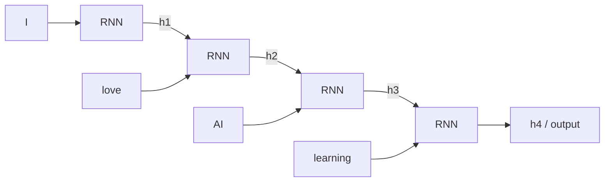

**In simple words:** an RNN reads data that comes in order, one step at a time. At every step it mixes the new input with a memory of the past (the hidden state) and passes the updated memory on.

**Definition:** an RNN is a type of neural network that has hidden states and allows past outputs to be used as inputs. It is designed to work with sequential data: "I will process the current input, but I will also carry some information from previous steps." <Cite id="class-dl-m5" loc="p. 9" /> <Cite id="class-dl-chp5" loc="slide 3" />

**Working, step by step** <Cite id="class-dl-chp5" loc="slide 7" />

1. Start with the first word and an empty memory.
2. At each time step the cell takes the **current input** and the **previous hidden state** and produces a **new hidden state** and an **output**.
3. The new hidden state is passed to the next step. "Recurrent" means repeated: the same cell and the same weights are used for every element.
4. In equations: $h_t = \tanh(U x_t + W h_{t-1} + b)$, $\hat{y}_t = \text{softmax}(V h_t + c)$.

**Learning:** after the forward pass the prediction is compared with the target to get the loss; **BPTT** sends the error backward through the time steps, and the weights are updated. <Cite id="class-dl-chp5" loc="slide 10" />

**Use:** sentiment analysis (many to one), image captioning (one to many), translation (many to many), speech recognition, next-word prediction. <Cite id="class-dl-chp5" loc="slide 8" /> <Cite id="class-dl-chp5" loc="slide 13" />

**Conclusion:** RNN = sequential data + previous information + hidden state.
