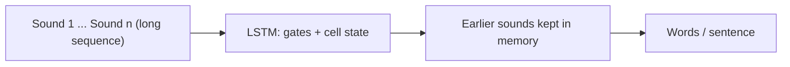

**In simple words:** RNN sequences ke liye suit karta hai kyunki wo pehle ke items yaad rakhta hai, lekin lambi sequences mein uski memory phiki pad jaati hai. LSTM apni memory bahut der tak rakhta hai, isliye jab bahut peeche ki baat answer tay kare tab behtar hai.

**RNN sequential data ke liye kaise suit karta hai:** sequence mein order matter karta hai aur pichhli information current prediction ko affect karti hai. Feedforward network ke paas pichhle inputs ki memory nahi hoti; RNN step se step **hidden state** carry karta hai aur har step par **same weights** use karta hai, isliye wo kam parameters mein kisi bhi length ki sequence handle karta hai. <Cite id="class-dl-chp5" loc="slide 5" /> <Cite id="class-dl-m5" loc="p. 8" />

**Long-term dependencies:** basic RNN ko important information kai time steps tak le jaana mushkil lagta hai, kyunki BPTT mein gradient vanish ho jaata hai. LSTM mein **cell state** (long-term memory) aur gates hain, isliye wo long-term dependencies handle karne ke liye designed hai. <Cite id="class-dl-chp5" loc="slide 11" /> <Cite id="class-dl-chp5" loc="slide 17" />

| Aspect | Standard RNN | LSTM |
|---|---|---|
| Memory | Hidden state | Hidden state + cell state |
| Long-term dependencies | Struggle kar sakta hai | Behtar handle karne ke liye designed |
| Gates | Gates nahi | Forget, input, output gates |
| Structure | Simpler | Zyada complex |
| Vanishing gradient | Problem ho sakti hai | Gates useful information bachate hain |

**Real-world application: speech recognition.** Audio sounds ki sequence ki tarah aata hai, aur kisi word ya sentence ka meaning bahut pehle sune sounds par depend kar sakta hai. LSTM sequence models ke liye popular algorithm hai aur Apple ke Siri aur Google ke voice search jaisi applications ke peeche hai. <Cite id="class-dl-m5" loc="p. 31" /> <Cite id="class-dl-chp5" loc="slide 19" />

**Yahan LSTM kyun behtar:** lambi utterance mein RNN shuruaati sounds kho deta; LSTM ke forget, input aur output gates useful pehli information ko cell state mein rakhte hain aur jab chahiye tab use karte hain.

**Conclusion:** RNN sequences ke liye suit karta hai; important pehli information wali lambi sequences ke liye LSTM zyada suitable hai. <Cite id="class-dl-chp5" loc="slide 19" />
