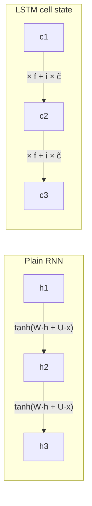

**In simple words:** RNN sequences ke liye suitable hai kyunki woh unhe ek step ek step padhta hai aur memory aage le jaata hai. Lekin plain RNN ki memory training ke dauraan jaldi fade ho jaati hai, isliye door ki baatein jodna mushkil hota hai. LSTM ek protected long-term memory jodta hai jisme gates hote hain, isliye woh information sau steps tak rakh sakta hai.

**1. Sequential data ke liye RNN kyun suitable hai**

- **Memory:** hidden state har step par naye input ko purani memory ke saath mix karta hai, isliye har output pehle ke inputs par depend kar sakta hai.
- **Koi bhi length:** same cell har step par lagti hai, isliye 5 ya 500 items wale sequence dono chalte hain.
- **Parameter sharing:** har step par same weights, isliye ek position par seekha pattern har jagah kaam karta hai.
- **Flexible shapes:** ek-se-bahut (captioning), bahut-se-ek (sentiment), bahut-se-bahut (translation). <Cite id="gfdl-ch10" loc="§10.2" />

**2. Long-term dependencies par RNN aur LSTM ka farak**

**Plain RNN.** Woh har step par poori memory ko squash karke dobara likhta hai. Training (backpropagation through time) mein gradient har step peeche jaate hue ek aise factor se multiply hota hai jo aam taur par 1 se kam hota hai, isliye kai steps ke baad woh **vanish** ho jaata hai aur lambi link kabhi seekhi nahi jaati.

**LSTM.** Iske paas ek alag **cell state** hoti hai jo teen gates se control hoti hai: forget (kya rakhna hai), input (kya jodna hai) aur output (kya dikhana hai). Memory forget gate se multiply karke aur naya information jodkar rakhi jaati hai <Cite id="d2l-lstm" />:

$$
c_t = f_t \odot c_{t-1} + i_t \odot \tilde{c}_t
$$

Is path par gradient sirf forget gate se multiply hota hai, jise network 1 ke paas rakh sakta hai, isliye woh kai steps tak bachta hai. <Cite id="hochreiter1997" />

| Point | Plain RNN | LSTM |
|---|---|---|
| Memory | Ek state, har step par dobara likhi | Cell state, rakhi aur usme jodi jaati hai |
| Gradient over many steps | Aam taur par vanish ya explode | Cell path par bachta hai jab forget gate 1 ke paas ho |
| Practical memory span | Practice mein chhoti, kyunki gradients fade ho jaate hain | Lambi; 1997 ke paper ne test tasks par 1000 se zyada steps ka lag paar kiya |
| Control | Koi nahi | Seekhe gates decide karte hain kya bhoolna, jodna, dikhana |
| Cost | Kam parameters, tez | Lagbhag 4 guna parameters, slow |

**3. Real-world application: machine translation**

"The book that my friend from college gave me last year is on the table" mein verb "is" ka sambandh "book" se hai, jo kaafi pehle aaya tha. Plain RNN shuru ke words bhool jaata hai (vanishing gradient), isliye agreement ya meaning galat ho jaati hai. LSTM ka forget gate 1 ke paas rakh sakta hai taaki "book, singular" uski cell state mein tab tak rahe jab tak zaroorat ho. Sutskever aur saathiyon ne deep LSTMs se English-to-French translator banaya aur bataya ki woh lambe sentences achhe se sambhalta hai. <Cite id="sutskever2014" /> Speech recognition ko bhi isi wajah se fayda hota hai. <Cite id="gfg-lstm" /> <Cite id="ibm-lstm" />

Exam mein English mein likho: "An LSTM keeps a separate cell state controlled by forget, input and output gates, so it captures long-term dependencies."

**Conclusion:** RNN memory aur weight sharing se sequences fit karta hai, lekin lambe gap mein uski memory fade ho jaati hai. LSTM ki gated memory long-term dependencies ko kahin behtar pakadti hai, isliye Transformers se pehle neural translation systems plain RNN ki jagah LSTM use karte the.
