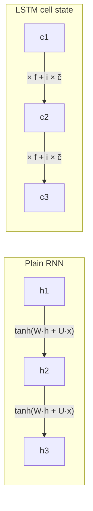

**In simple words:** an RNN suits sequences because it reads them one step at a time and carries a memory forward. But a plain RNN's memory fades quickly during training, so it struggles to connect things far apart. An LSTM adds a protected long-term memory with gates, so it can keep information for hundreds of steps.

**1. Why RNNs suit sequential data**

- **Memory:** the hidden state mixes the new input with the previous memory at every step, so each output can depend on earlier inputs.
- **Any length:** the same cell is applied once per step, so sequences of 5 or 500 items work.
- **Parameter sharing:** the same weights at every step, so a pattern learned at one position works everywhere.
- **Flexible shapes:** one-to-many (captioning), many-to-one (sentiment), many-to-many (translation). <Cite id="gfdl-ch10" loc="§10.2" />

**2. RNN versus LSTM on long-term dependencies**

**Plain RNN.** It squashes and rewrites its whole memory every step. In training (backpropagation through time) the gradient is multiplied at every step back by a factor usually below 1, so after many steps it **vanishes** and long links are never learned.

**LSTM.** It keeps a separate **cell state** controlled by three gates: forget (what to keep), input (what to add) and output (what to show). The memory is kept by multiplying with the forget gate and adding new information <Cite id="d2l-lstm" />:

$$
c_t = f_t \odot c_{t-1} + i_t \odot \tilde{c}_t
$$

Along this path the gradient is multiplied only by the forget gate, which the network can keep near 1, so it survives many steps. <Cite id="hochreiter1997" />

| Point | Plain RNN | LSTM |
|---|---|---|
| Memory | One state, rewritten every step | Cell state, kept and added to |
| Gradient over many steps | Usually vanishes or explodes | Survives along the cell path when the forget gate is near 1 |
| Practical memory span | Short in practice, because gradients fade | Long; the 1997 paper bridged lags of over 1000 steps on test tasks |
| Control | None | Learned gates decide what to forget, add, output |
| Cost | Fewer parameters, faster | About 4 times the parameters, slower |

**3. Real-world application: machine translation**

In "The book that my friend from college gave me last year is on the table", the verb "is" depends on "book", many words earlier. A plain RNN loses the early words (vanishing gradient), so agreement or meaning goes wrong. An LSTM's forget gate can stay near 1 to keep "book, singular" in its cell state until needed. Sutskever and others built an English-to-French translator from deep LSTMs and reported that it handled long sentences well. <Cite id="sutskever2014" /> Speech recognition benefits for the same reason. <Cite id="gfg-lstm" /> <Cite id="ibm-lstm" />

**Conclusion:** RNNs fit sequences through memory and weight sharing, but their memory fades over long gaps. The LSTM's gated memory captures long-term dependencies much better, which is why neural translation systems (before Transformers) used LSTMs instead of plain RNNs.
