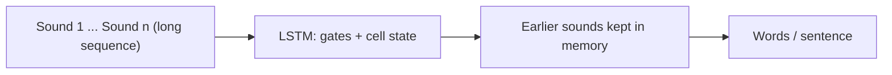

**In simple words:** an RNN suits sequences because it remembers earlier items, but its memory fades over long sequences. An LSTM keeps its memory much longer, so it is better when something far back decides the answer.

**How an RNN suits sequential data:** in a sequence the order matters and previous information affects the current prediction. A feedforward network has no memory of previous inputs; an RNN carries a **hidden state** from step to step and uses the **same weights** at every step, so it handles sequences of any length with fewer parameters. <Cite id="class-dl-chp5" loc="slide 5" /> <Cite id="class-dl-m5" loc="p. 8" />

**Long-term dependencies:** a basic RNN struggles to carry important information across many time steps, because the gradient vanishes during BPTT. An LSTM has a **cell state** (long-term memory) and gates, so it is designed to handle long-term dependencies. <Cite id="class-dl-chp5" loc="slide 11" /> <Cite id="class-dl-chp5" loc="slide 17" />

| Aspect | Standard RNN | LSTM |
|---|---|---|
| Memory | Hidden state | Hidden state + cell state |
| Long-term dependencies | Can struggle | Designed to handle better |
| Gates | No gates | Forget, input, output gates |
| Structure | Simpler | More complex |
| Vanishing gradient | Can be a problem | Gates help preserve useful information |

**Real-world application: speech recognition.** The audio arrives as a sequence of sounds, and the meaning of a word or sentence can depend on sounds heard much earlier. LSTM is a popular algorithm for sequence models and is behind applications such as Apple's Siri and Google's voice search. <Cite id="class-dl-m5" loc="p. 31" /> <Cite id="class-dl-chp5" loc="slide 19" />

**Why LSTM is better here:** an RNN would lose the early sounds over a long utterance; the LSTM's forget, input and output gates keep the useful earlier information in the cell state and use it when it is needed.

**Conclusion:** RNN suits sequences; for long sequences with important earlier information, LSTM is more suitable. <Cite id="class-dl-chp5" loc="slide 19" />
