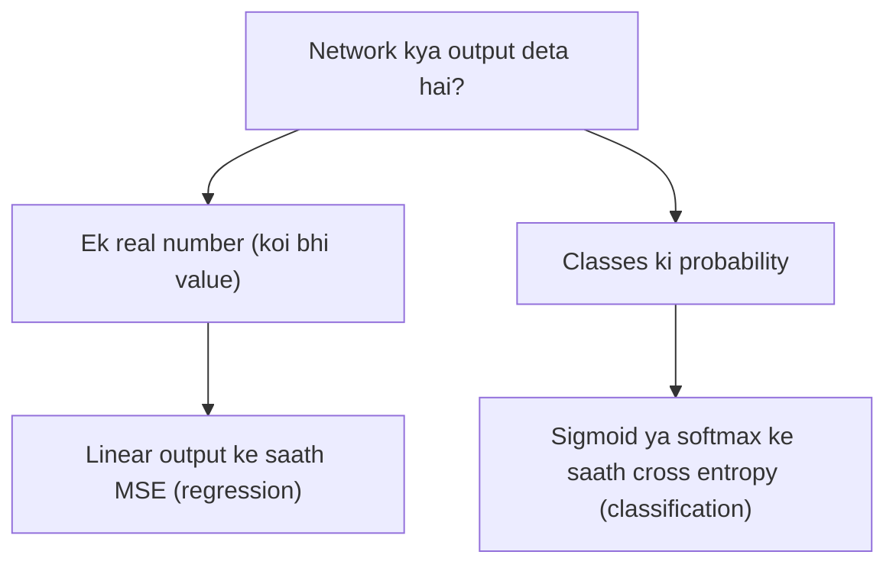

**In simple words:** loss function network ko batata hai ki wo kitna galat hai; MSE numbers ke beech ki doori naapta hai, jabki cross entropy naapta hai ki predicted probability kitni galat hai. Classification ke liye cross entropy behtar choice hai. <Cite id="class-dl-m2" loc="p. 14" />

**Loss function ka role.** Ye predicted output aur actual output ka difference naapta hai. Forward pass ke baad loss nikalta hai; backpropagation use peeche bhejti hai weights update karne ke liye; ye tab tak repeat hota hai jab tak loss chhota na ho. Kam loss matlab behtar model. <Cite id="class-dl-chp2" loc="slide 26" />

**Comparison** <Cite id="class-dl-m2" loc="p. 14" />

| | MSE (squared error) | Cross entropy |
|---|---|---|
| Usage | Regression (continuous target) | Classification (categorical target) |
| Formula | $\frac{1}{n}\sum (y_i - \hat y_i)^2$ | $-\frac{1}{n}\sum [y_i\log\hat y_i + (1 - y_i)\log(1 - \hat y_i)]$ |
| Output range | Koi bhi real value | 0 se 1 (probabilities) |
| Output layer | Linear | Sigmoid ya softmax |
| Penalty | Quadratic, chhote errors ke liye kam sensitive; outliers ke prati sensitive | Logarithmic, confident galat prediction par bahut high |
| Impact | House price jaise numbers predict karne ke liye achha | Classes ke liye faster convergence aur better gradients |

**Cross entropy kab zyada appropriate hai.** Classification mein output 0 aur 1 ke beech ki probability hai aur target class hai. Cross entropy probability ko actual class se compare karta hai aur confident galat predictions ko bahut zyada penalize karta hai; ye faster convergence ke liye better gradient behavior bhi deta hai. <Cite id="class-dl-m2" loc="p. 14" />

**Example (spam ya not spam).** Actual class $y = 1$ (spam). Prediction A: probability 0.9 se cross entropy $-\ln 0.9 = 0.105$ (small). Prediction B: probability 0.1 se $-\ln 0.1 = 2.303$ (very large). Galat, confident prediction B ko heavily punish kiya jaata hai, isliye network use jaldi sudhaarta hai. <Cite id="class-dl-m2" loc="p. 14" />

**Conclusion:** regression ke liye MSE aur sigmoid ya softmax output wali classification ke liye cross entropy use karo.
