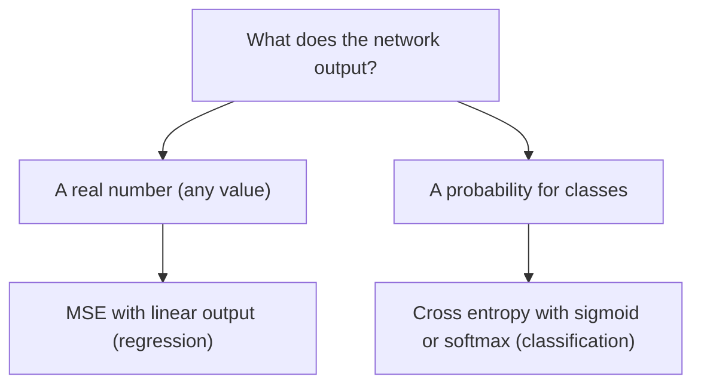

**In simple words:** the loss function tells the network how wrong it is; MSE measures the distance between numbers, while cross entropy measures how wrong a predicted probability is. For classification, cross entropy is the better choice. <Cite id="class-dl-m2" loc="p. 14" />

**Role of the loss function.** It measures the difference between the predicted output and the actual output. After the forward pass the loss is calculated; backpropagation sends it back to update the weights; this repeats until the loss is small. Lower loss means a better model. <Cite id="class-dl-chp2" loc="slide 26" />

**Comparison** <Cite id="class-dl-m2" loc="p. 14" />

| | MSE (squared error) | Cross entropy |
|---|---|---|
| Usage | Regression (continuous target) | Classification (categorical target) |
| Formula | $\frac{1}{n}\sum (y_i - \hat y_i)^2$ | $-\frac{1}{n}\sum [y_i\log\hat y_i + (1 - y_i)\log(1 - \hat y_i)]$ |
| Output range | Any real value | 0 to 1 (probabilities) |
| Output layer | Linear | Sigmoid or softmax |
| Penalty | Quadratic, less sensitive for small errors; sensitive to outliers | Logarithmic, very high for a confident wrong prediction |
| Impact | Good for predicting numbers like house price | Faster convergence and better gradients for classes |

**When cross entropy is more appropriate.** In classification the output is a probability between 0 and 1 and the target is a class. Cross entropy compares the probability with the actual class and penalizes confident wrong predictions very heavily; it also gives better gradient behavior for faster convergence. <Cite id="class-dl-m2" loc="p. 14" />

**Example (spam or not spam).** Actual class $y = 1$ (spam). Prediction A: probability 0.9 gives cross entropy $-\ln 0.9 = 0.105$ (small). Prediction B: probability 0.1 gives $-\ln 0.1 = 2.303$ (very large). The wrong, confident prediction B is punished heavily, so the network corrects it quickly. <Cite id="class-dl-m2" loc="p. 14" />

**Conclusion:** use MSE for regression and cross entropy for classification with sigmoid or softmax outputs.
