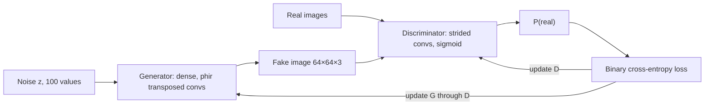

**In simple words:** GAN (Generative Adversarial Network) do competing neural networks hote hain. **Generator** random noise se fake samples banata hai; **discriminator** faisla karta hai ki sample real hai ya fake. Ek forger aur detective ki tarah, dono ek-dusre ko haraakar behtar hote hain, jab tak fake real jaisa na dikhne lage.

**Definition.** GAN (Goodfellow et al., 2014) ek generative model hai jisme generator aur discriminator ek do-khiladi game ki tarah ek-dusre ke against train hote hain.

**Why it is needed.** Yeh bina labels ke, naya aur realistic data banata hai, aur har image ki exact probability nikale bina, jo purane generative models ke liye bahut mushkil tha.

**Architecture in detail**

1. **Latent noise $z$:** random numbers ka vector, jaise 100 random numbers. Alag $z$ se alag output milta hai.
2. **Generator:** $z$ ko real data jaisi shape ke sample mein badalta hai. Vanilla GAN mein yeh fully connected network hai. DCGAN mein $z$ ek chhote $4 \times 4$ block mein reshape hota hai, aur **transposed convolutions** har layer par size double karte hain, $64 \times 64 \times 3$ image tak. Ismein batch normalization, ReLU, aur output par tanh hai.
3. **Real data $x$:** bina label ke training examples.
4. **Discriminator:** ek classifier (DCGAN mein pooling ki jagah strided convolutions aur leaky ReLU wala CNN) jo sigmoid par khatam hota hai. Woh batata hai ki input real hone ki probability kitni hai.
5. **Loss aur backpropagation:** D ka output sahi label se compare hota hai (real = 1, fake = 0). Error D ko update karta hai, aur D se hote hue G tak wapas jaata hai taaki G bhi update ho.

**Objective.** D real data ko "real" aur fakes ko "fake" bolna seekhta hai; G apne fakes ke liye D se "real" bulwana chahta hai:

$$
\min_G \max_D \; \mathbb{E}_{x \sim p_{\text{data}}}[\ln D(x)] + \mathbb{E}_{z \sim p_z}[\ln(1 - D(G(z)))]
$$

**Training.** (1) D ko real aur fake samples ke batch par train karo, G frozen rakhkar; (2) G ko train karo ki woh D ko dhokha de, D frozen rakhkar; (3) repeat. Ideal end point par fakes real data se mil jaate hain aur D har jagah $0.5$ dene lagta hai; phir D ko hata diya jaata hai.

**Advantages aur disadvantages.** Bina labels ke sharp, realistic samples; lekin training unstable hoti hai aur mode collapse ho sakta hai.

**Applications of GAN**

- **Image generation:** photorealistic chehre (StyleGAN), art aur game assets.
- **Image-to-image translation:** sketch se photo (pix2pix), horse se zebra (CycleGAN).
- **Super-resolution:** dhundli image se saaf high-resolution image (SRGAN).
- **Text-to-image, inpainting aur photo editing.**
- **Data augmentation:** rare classes ya private medical data ke liye synthetic data.
- **Deepfakes:** realistic chehre ya awaaz ki swap, film mein kaam aati hai.

**Comment.** Ye applications isliye chalte hain kyunki GAN ke outputs real dikhte hain; wahi realism deepfakes ko misinformation phailane deta hai, isliye detection tools aur kanoon zaroori hain.

Exam mein English mein likho: "A GAN has two networks, a generator and a discriminator, trained as a minimax game."

**Conclusion:** GAN ek generator-discriminator jodi hai jo minimax game ki tarah train hoti hai, aur vision, media aur healthcare mein wide use hoti hai.
