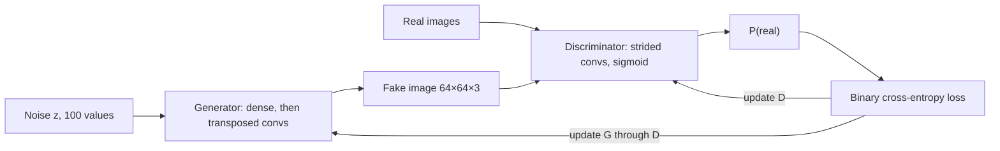

**In simple words:** a GAN (Generative Adversarial Network) is two competing neural networks. The **generator** makes fake samples from random noise; the **discriminator** judges whether a sample is real or fake. Like a forger and a detective, each improves by beating the other, until the fakes look real.

**Definition.** A GAN (Goodfellow et al., 2014) is a generative model in which a generator and a discriminator are trained against each other as a two-player game.

**Why it is needed.** It makes new, realistic data without labels and without computing the exact probability of each image, which older generative models found very hard.

**Architecture in detail**

1. **Latent noise $z$:** a vector of random numbers, for example 100 random numbers. A different $z$ gives a different output.
2. **Generator:** turns $z$ into a sample of the same shape as the real data. In the vanilla GAN it is a fully connected network. In DCGAN, $z$ is reshaped into a small $4 \times 4$ block, and **transposed convolutions** double the size at each layer up to a $64 \times 64 \times 3$ image. It uses batch normalization, ReLU, and tanh at the output.
3. **Real data $x$:** unlabelled training examples.
4. **Discriminator:** a classifier (in DCGAN a CNN with strided convolutions instead of pooling, and leaky ReLU) ending in a sigmoid. It outputs the probability that its input is real.
5. **Loss and backpropagation:** D's output is compared with the true label (real = 1, fake = 0). The error updates D, and flows back through D to update G.

**Objective.** D tries to say "real" to real data and "fake" to fakes; G tries to make D say "real" to its fakes:

$$
\min_G \max_D \; \mathbb{E}_{x \sim p_{\text{data}}}[\ln D(x)] + \mathbb{E}_{z \sim p_z}[\ln(1 - D(G(z)))]
$$

**Training.** (1) Train D on a batch of real and fake samples with G frozen; (2) train G to fool D with D frozen; (3) repeat. At the ideal end point the fakes match the real data and D outputs $0.5$ everywhere; D is then discarded.

**Advantages and disadvantages.** Sharp, realistic samples with no labels; but training is unstable and may suffer mode collapse.

**Applications of GAN**

- **Image generation:** photorealistic faces (StyleGAN), art and game assets.
- **Image-to-image translation:** sketch to photo (pix2pix), horse to zebra (CycleGAN).
- **Super-resolution:** sharp high-resolution images from blurry ones (SRGAN).
- **Text-to-image, inpainting and photo editing.**
- **Data augmentation:** synthetic data for rare classes or private medical data.
- **Deepfakes:** realistic face or voice swaps, useful in film.

**Comment.** These applications work because GAN outputs look real; the same realism lets deepfakes spread misinformation, so detection tools and laws are needed.

**Conclusion:** a GAN is a generator-discriminator pair trained as a minimax game, widely used in vision, media and healthcare.
