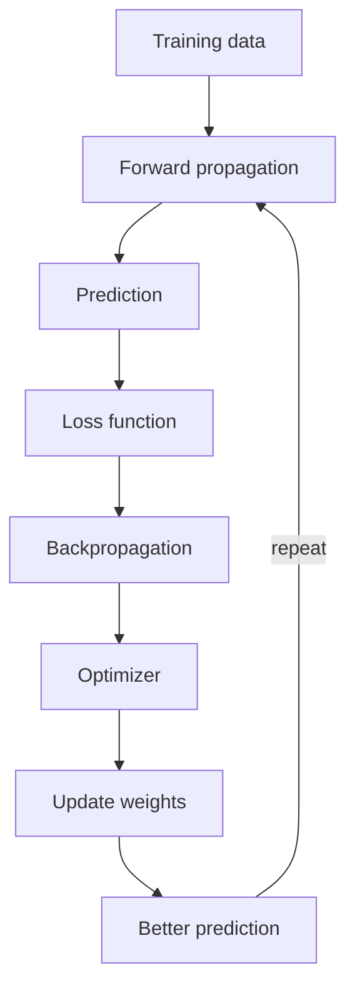

**In simple words:** network ek loop repeat karke seekhta hai: andaza lagao (forward propagation), galti naapo (loss), pata lagao galti kiski hai (backpropagation), aur weights theek karo (optimizer). <Cite id="class-dl-chp2" loc="slide 59" />

**1. Forward propagation.** Input, input layer, hidden layers aur output layer se guzarta hai; information sirf aage jaati hai aur prediction deti hai. <Cite id="class-dl-chp2" loc="slide 4" /> <Cite id="class-dl-m1" loc="p. 26" />

**2. Loss calculation.** Prediction ko actual value se compare karke error nikalte hain (actual 180 g, predicted 220 g: loss high). Loss sirf batata hai kitna error hai, ye nahi ki kaun sa weight badalna hai. <Cite id="class-dl-chp2" loc="slide 57" />

**3. Backpropagation.** Ye cost ki information ko network mein peeche flow karne deta hai taaki gradient compute ho, jo loss ka slope hai: uska sign direction batata hai aur size batata hai loss kitni tez badalta hai. Ye sirf gradient compute karta hai. <Cite id="class-dl-m1" loc="p. 26" /> <Cite id="class-dl-chp2" loc="slide 58" />

**4. Optimization aur weight update.** Optimizer (GD, SGD, Adam) gradient se weights update karta hai: $W_{new} = W_{old} - \eta \dfrac{\partial L}{\partial W}$, jahan $\eta$ learning rate hai. Gradient positive ya negative ho to slope ke ulta move karo; zero ho to minimum ya saddle point ho sakta hai. <Cite id="class-dl-chp2" loc="slides 57 and 63" />

**Example:** $x = 2$, $y = 4$, $w = 3$ se $\hat y = 6$ aur loss $(6 - 4)^2 = 4$; gradient $2(\hat y - y)x = 8$; $\eta = 0.1$ ke saath $w = 3 - 0.8 = 2.2$, aur naya loss $(4.4 - 4)^2 = 0.16$. (Loss ka derivative class files mein nahi hai; numbers sirf ek cycle dikhate hain.)

**Repeat** jab tak loss chhota na ho. **Problems:** vanishing gradient (tiny gradients, early layers seekhna band) aur exploding gradient (huge gradients, unstable training). <Cite id="class-dl-chp2" loc="slides 64 to 67" />

**Conclusion:** forward propagation predict karta hai, loss naapta hai, backpropagation gradient deta hai aur optimizer weights update karta hai.

Exam mein English mein likho: "Forward propagation makes the prediction, the loss measures the error, backpropagation computes the gradient and the optimizer updates the weights."
