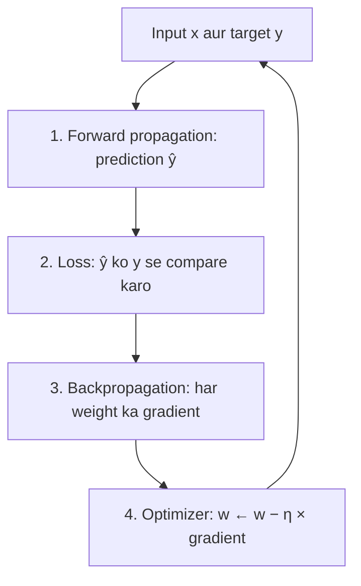

**In simple words:** neural network ek student ki tarah seekhta hai jo answer key se practice karta hai. Woh ek guess lagata hai, check karta hai ki kitni galti hui, pata lagata hai ki kaun se weight ne galti karayi, aur use thoda badalta hai. Hazaron baar repeat karne se guesses achhe ho jaate hain.

**Definition:** learning process woh repeated loop hai jisse network apne weights aur biases adjust karta hai taaki predictions sahi jawabon se match karein. Naya network random weights se shuru hota hai, isliye hamein ek automatic tareeka chahiye jo har weight ko bataye ki upar jaana hai ya neeche.

**1. Forward propagation (kaam: prediction banana).** Input layer-by-layer aage jaata hai. Har neuron apne inputs ka weighted sum leta hai, bias jodta hai aur activation function lagata hai. Aakhri layer prediction deti hai.

**2. Loss calculation (kaam: galti napna).** Loss function error ko ek number mein badalta hai: numbers ke liye squared error, classes ke liye cross-entropy. Bada loss matlab galat guess.

**3. Backpropagation (kaam: dosh dhoondhna).** Output se shuru karke error peeche bheja jaata hai. Chain rule se har weight ko apna hissa dosh milta hai, uska gradient $\partial L / \partial w$, ek hi backward pass se.

**4. Optimization (kaam: weights sudharna).** Optimizer har weight ko uske gradient ke against badalta hai: $w \leftarrow w - \eta\,\dfrac{\partial L}{\partial w}$. Positive gradient weight ko ghatata hai; negative badhata hai. Learning rate $\eta$ badlav ka size tay karta hai. Ye mini-batches par hota hai, aksar momentum ya Adam ke saath.

**Example: ek update.**

<Sum>

<Given>

ek linear neuron $\hat{y} = w x$, $w = 0.3$, input $x = 2$, target $y = 1$, loss $L = \tfrac{1}{2}(\hat{y} - y)^2$, learning rate $\eta = 0.1$.

</Given>

<Find>

ek update ke baad weight.

</Find>

<Steps>

1. **Forward:** $\hat{y} = 0.3 \times 2 = 0.6$.
2. **Loss:** $L = \tfrac{1}{2}(0.6 - 1)^2 = 0.08$.
3. **Backward:**

   $$
   \begin{aligned}
   \partial L / \partial w &= (\hat{y} - y)\,x \\
   &= (-0.4)(2) \\
   &= -0.8
   \end{aligned}
   $$

   Negative sign kehta hai: $w$ badhao.
4. **Update:** $w = 0.3 - 0.1 \times (-0.8) = 0.38$.

</Steps>

<Answer>

naya weight $w = 0.38$ hai.

</Answer>

<Box kind="verify">

Forward pass dobara chalao: $\hat{y} = 0.38 \times 2 = 0.76$ aur $L = \tfrac{1}{2}(0.24)^2 = 0.0288$, jo 0.08 se kam hai. Gradient ko nudge karke check karo: $w = 0.31$ pe $L = \tfrac{1}{2}(0.62 - 1)^2 = 0.0722$, to slope $(0.0722 - 0.08)/0.01 \approx -0.78$, jo $-0.8$ ke kareeb hai.

</Box>

</Sum>

**Limitations:** deep networks mein vanishing ya exploding gradients; labelled data aur achhi learning rate chahiye.

**Conclusion:** forward propagation predict karta hai, loss galti napta hai, backpropagation dosh tay karta hai, aur optimizer weights ko sudharta hai.

Exam mein English mein likho: "Backpropagation finds the gradient of the loss for every weight, and the optimizer updates each weight against its gradient."
