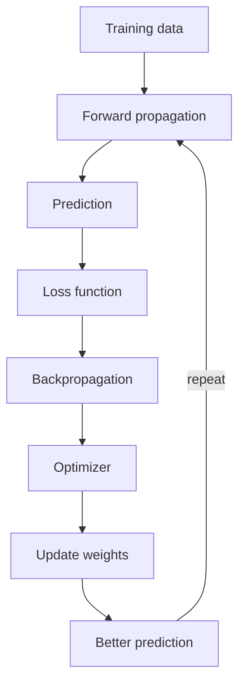

**In simple words:** a network learns by repeating a loop: guess (forward propagation), measure the mistake (loss), find who is to blame (backpropagation), and fix the weights (optimizer). <Cite id="class-dl-chp2" loc="slide 59" />

**1. Forward propagation.** The input goes through the input layer, the hidden layers and the output layer; information flows only forward and gives a prediction. <Cite id="class-dl-chp2" loc="slide 4" /> <Cite id="class-dl-m1" loc="p. 26" />

**2. Loss calculation.** The prediction is compared with the actual value to find the error (actual 180 g, predicted 220 g: loss is high). The loss only tells how much error exists, not which weight to change. <Cite id="class-dl-chp2" loc="slide 57" />

**3. Backpropagation.** It allows the information from the cost to flow backwards through the network to compute the gradient, the slope of the loss: its sign gives the direction and its size tells how fast the loss changes. It only computes the gradient. <Cite id="class-dl-m1" loc="p. 26" /> <Cite id="class-dl-chp2" loc="slide 58" />

**4. Optimization and weight update.** The optimizer (GD, SGD, Adam) uses the gradient to update the weights: $W_{new} = W_{old} - \eta \dfrac{\partial L}{\partial W}$, where $\eta$ is the learning rate. A positive or negative gradient means move opposite to the slope; zero means a minimum or saddle point may be reached. <Cite id="class-dl-chp2" loc="slides 57 and 63" />

**Example:** $x = 2$, $y = 4$, $w = 3$ gives $\hat y = 6$ and loss $(6 - 4)^2 = 4$; the gradient $2(\hat y - y)x = 8$; with $\eta = 0.1$, $w = 3 - 0.8 = 2.2$, and the new loss is $(4.4 - 4)^2 = 0.16$. (The loss derivative is not in the class files; the numbers only show one cycle.)

**Repeat** until the loss is small. **Problems:** vanishing gradient (tiny gradients, early layers stop learning) and exploding gradient (huge gradients, unstable training). <Cite id="class-dl-chp2" loc="slides 64 to 67" />

**Conclusion:** forward propagation predicts, the loss measures, backpropagation gives the gradient and the optimizer updates the weights.
