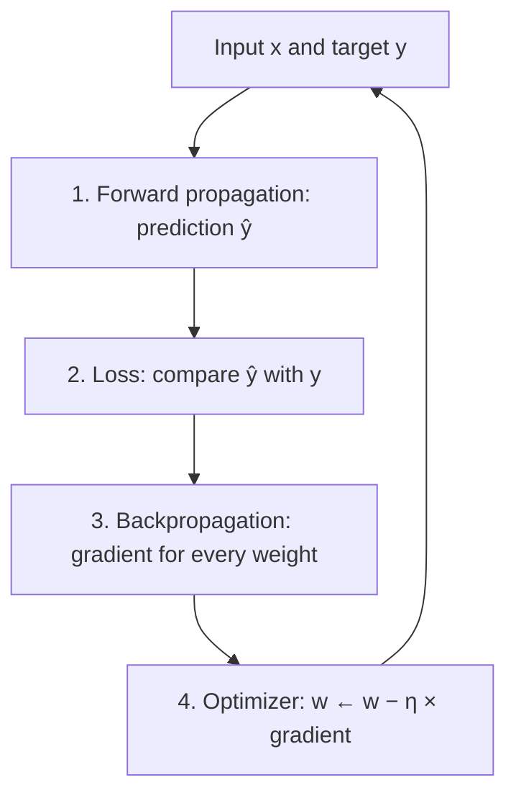

**In simple words:** a neural network learns like a student practising with an answer key. It makes a guess, checks how wrong it was, works out which of its weights caused the mistake, and changes them a little. Repeating this thousands of times makes the guesses good.

**Definition:** the learning process is the repeated loop by which a network adjusts its weights and biases so that its predictions match the correct answers. A new network starts with random weights, so we need an automatic way to tell every weight whether to go up or down.

**1. Forward propagation (role: make a prediction).** The input passes layer by layer. Each neuron takes a weighted sum of its inputs plus a bias and applies an activation function. The last layer gives the prediction.

**2. Loss calculation (role: measure the mistake).** The loss function turns the error into one number: squared error for numbers, cross-entropy for classes. A large loss means a bad guess.

**3. Backpropagation (role: find who is to blame).** Starting at the output, the error is sent backwards. Using the chain rule, every weight gets its share of the blame, its gradient $\partial L / \partial w$, from one backward pass.

**4. Optimization (role: correct the weights).** The optimizer moves each weight against its gradient: $w \leftarrow w - \eta\,\dfrac{\partial L}{\partial w}$. A positive gradient lowers the weight; a negative one raises it. The learning rate $\eta$ sets the size of the change. This is done on mini-batches, often with momentum or Adam.

**Example: one update.**

<Sum>

<Given>

one linear neuron $\hat{y} = w x$ with $w = 0.3$, input $x = 2$, target $y = 1$, loss $L = \tfrac{1}{2}(\hat{y} - y)^2$, learning rate $\eta = 0.1$.

</Given>

<Find>

the weight after one update.

</Find>

<Steps>

1. **Forward:** $\hat{y} = 0.3 \times 2 = 0.6$.
2. **Loss:** $L = \tfrac{1}{2}(0.6 - 1)^2 = 0.08$.
3. **Backward:**

   $$
   \begin{aligned}
   \partial L / \partial w &= (\hat{y} - y)\,x \\
   &= (-0.4)(2) \\
   &= -0.8
   \end{aligned}
   $$

   The negative sign says: raise $w$.
4. **Update:** $w = 0.3 - 0.1 \times (-0.8) = 0.38$.

</Steps>

<Answer>

the new weight is $w = 0.38$.

</Answer>

<Box kind="verify">

Run the forward pass again: $\hat{y} = 0.38 \times 2 = 0.76$ and $L = \tfrac{1}{2}(0.24)^2 = 0.0288$, lower than 0.08. Check the gradient by nudging: at $w = 0.31$, $L = \tfrac{1}{2}(0.62 - 1)^2 = 0.0722$, so the slope is $(0.0722 - 0.08)/0.01 \approx -0.78$, close to $-0.8$.

</Box>

</Sum>

**Limitations:** vanishing or exploding gradients in deep networks; needs labelled data and a well-chosen learning rate.

**Conclusion:** forward propagation predicts, the loss measures the mistake, backpropagation assigns the blame, and the optimizer corrects the weights.
