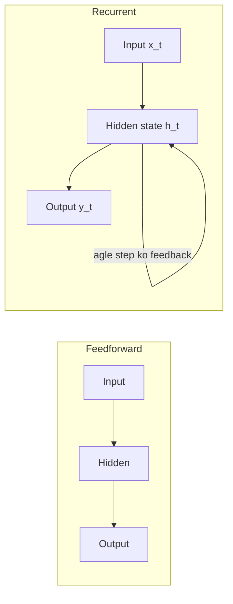

**In simple words:** feedforward network data ko sirf ek taraf bhejta hai, isliye uski memory nahi hoti. Recurrent network apni memory (hidden state) har step par wapas andar daalta hai, isliye wo sequences par kaam kar sakta hai. <Cite id="class-dl-m1" loc="p. 10" />

**Feedforward neural network (FFNN):** layers input, hidden aur output hoti hain; data sirf input se output ki taraf jaata hai aur koi loop nahi hota. Har neuron $z = \sum_i w_ix_i + b$ nikalta hai aur $a = f(z)$ deta hai, aur output agli layer ko jaata hai. Output sirf current input par depend karta hai. <Cite id="class-dl-chp1" loc="slide 28" />

**Recurrent neural network (RNN):** har time step par cell current input $x_t$ aur previous hidden state $h_{t-1}$ leta hai aur naya hidden state $h_t$ aur output deta hai. Har step par same weights use hote hain. <Cite id="class-dl-chp5" loc="slide 7" /> <Cite id="class-dl-m5" loc="p. 9" />

| | Feedforward | Recurrent |
|---|---|---|
| Data flow | Ek taraf, loop nahi | Hidden state wapas jaati hai |
| Memory | Nahi | Pichhle inputs yaad rakhta hai |
| Input | Fixed-size input | Kisi bhi length ka sequence |
| Use | Tabular data, classification | Text, speech, time series |

**Conclusion:** FFNN ek baar mein ek input handle karta hai; RNN ordered data ke liye memory jodta hai. <Cite id="class-dl-chp5" loc="slide 5" />
